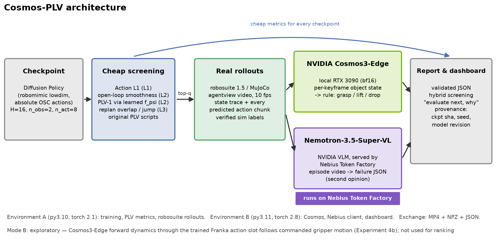
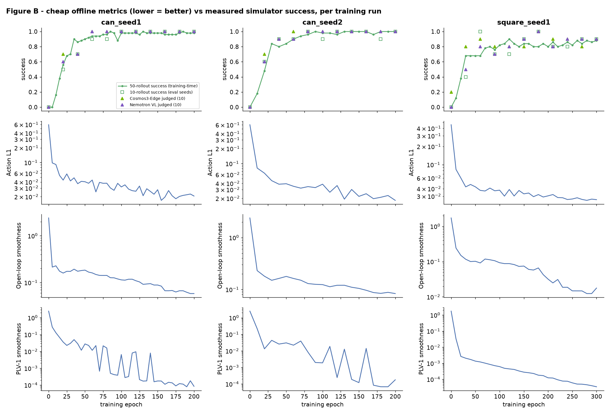
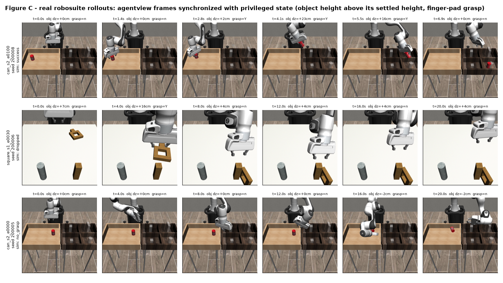
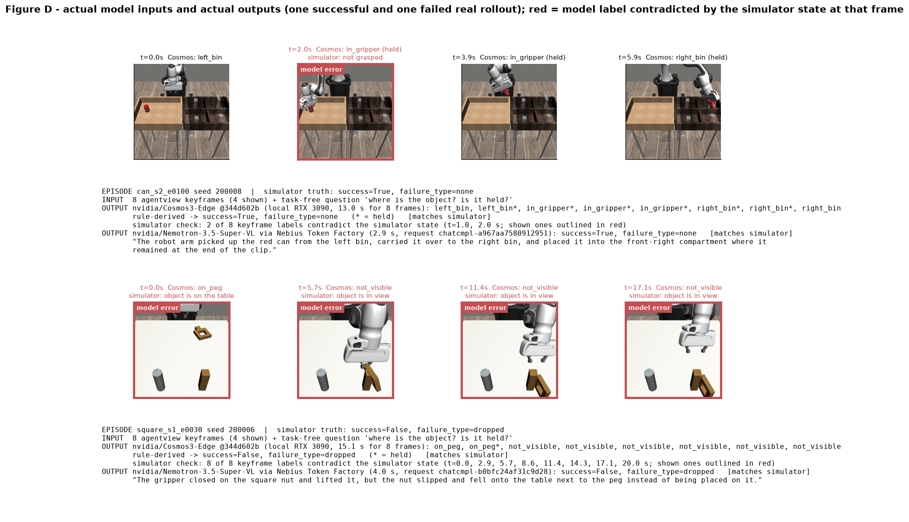
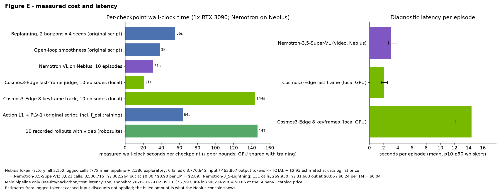

# Cosmos-PLV: World-Model-Guided Robot Policy Evaluation

**Nebius x NVIDIA Global AI Hackathon 2026 — Physical AI track**

Cosmos-PLV helps a robotics researcher decide **which imitation-learning
checkpoint to evaluate next, and why**. It combines lightweight offline
checkpoint screening (PLV, Policy-in-the-Loop Latent Validation, from our prior
research) with real simulator rollouts and physical-outcome judgements from NVIDIA
models: **NVIDIA Cosmos3-Edge** on a local GPU, and **NVIDIA
Nemotron-3.5-Super-VL** on **Nebius Token Factory**.

**TL;DR**
* **Workflow:** free offline PLV metrics pick which checkpoints get robot time.
  Zero-shot NVIDIA judges then replace the hand-coded success detector, and every
  call is logged.
* **Measured:** on 330 recorded simulator rollouts, success accuracy is 0.964 for Nemotron on
  Nebius and 0.918 for Cosmos3-Edge running locally, with no fine-tuning. Ranking
  checkpoints with VLM verdicts is as good as with privileged simulator labels.
  Adaptive allocation needs 2–3x fewer rollouts, and early abort saves 16–20% of
  robot time.
* **Not (yet):** it does not beat "pick the latest epoch" in these short runs, and
  it does not classify failure types. It cannot yet replace rollouts with
  predicted video. In an exploratory test, Cosmos3-Edge's trained Franka action
  slot moved the generated gripper roughly along the recorded motion (cos ≈ 0.8 on
  15 clips from 5 initial states; strong on Can, weak on Square). The motion is
  compressed, though, and pixel fidelity is no better than a frozen frame
  (Experiment 4b).



## The problem

Low training or validation error does not imply high closed-loop task success.
Teacher-forced validation scores actions on recorded expert observations; at
deployment the policy's own actions change what it sees next. Checkpoints with
similar offline losses can behave very differently on the robot, and every
real evaluation rollout is expensive. Our earlier study ("Cheap Metrics First,
Replanning Diagnostics Second", 1,365 checkpoints, see
[docs/hackathon/08_original_vs_new_work.md](docs/hackathon/08_original_vs_new_work.md))
found that cheap metrics such as Action L1 and open-loop action smoothness are
useful screens, but that a bigger learned dynamics model did not make ranking
more reliable.

The question for this hackathon: **can NVIDIA physical-AI models add useful
diagnostic information beyond cheap offline metrics, at practical cost?**

## Related work and what is new here

Prior work this builds on:
* **VLM success detection:** SuccessVQA ([Du et al. 2023](https://arxiv.org/abs/2303.07280)).
* **Autonomous real-robot policy evaluation:** [AutoEval](https://arxiv.org/abs/2503.24278)
  (CoRL 2025) fine-tunes a PaliGemma success classifier per scene on about 1,000
  labelled images.
* **Simulation as an evaluation proxy:** [SIMPLER](https://arxiv.org/abs/2405.05941).
* **Policy evaluation inside learned world models:**
  [WorldGym](https://arxiv.org/abs/2506.00613) and
  [Ctrl-World](https://arxiv.org/abs/2510.10125), both trained on robot data.
* **Failure reasoning, which these works find hard:**
  [REFLECT](https://arxiv.org/abs/2306.15724), [AHA](https://arxiv.org/abs/2410.00371),
  and RoboFail in [Cosmos-Reason1](https://arxiv.org/abs/2503.15558).

We do not claim the idea of a VLM judge or a world-model evaluator. What is new:
1. **Integration.** The judges sit after an offline checkpoint screen (PLV) in one
   logged workflow, and that workflow runs in the app.
2. **Zero-shot, open NVIDIA models.** There is no per-scene fine-tuning or labelling.
   Note that this is simulation, while AutoEval runs on a real robot.
3. **Effect on the decision itself.** We measure ranking quality at an equal rollout
   budget, not only judge accuracy.
4. **Pitfalls that we found and controlled for.**
   * Clip-length leakage.
   * A goal-prompted model narrating its plan instead of the video ("judge, don't
     plan").
   * Camera choice mattering more than image quality.
   * An untrained action slot in the released Cosmos3-Edge checkpoint.
5. **A zero-shot check of Cosmos3-Edge action conditioning on another simulator's
   robot** (Experiment 4b).

The earlier paper and its public site:
[cheesss.github.io/plv-checkpoint-screening](https://cheesss.github.io/plv-checkpoint-screening/).

## What the application does

1. **Load a Diffusion Policy checkpoint** and read its execution contract from the
   checkpoint itself (horizon 16, 2 observation steps, 8 executed actions).
2. **Cheap screening** with the original PLV scripts: Action L1 (Level 1),
   open-loop smoothness and PLV-1 model-feedback smoothness (Level 2),
   execution-matched replanning overlap / boundary jump (Level 3).
3. **Real rollouts** in robosuite 1.5 (MuJoCo): agentview video, privileged
   simulator state and every predicted action chunk, with verified outcome labels
   (`success`, `no_grasp`, `dropped`, `not_placed`, `other`).
4. **Physical diagnostics** from video:
   * Cosmos3-Edge answers task-free questions about the object ("where is the
     can?"). Success is judged from the last frame. For the failure type, 8 keyframes
     go through a fixed grasp / lift / drop rule.
   * Nemotron-3.5-Super-VL on Nebius watches the episode video and returns a
     schema-validated failure report.
5. **Recommendation**: keep the cheap-metric top 30 %, then rank by VLM-judged
   success of recorded attempts. The free "latest epoch" pick and each rule's
   measured regret are shown next to it. In this pool the two-stage rule does
   **not** beat the epoch pick (Experiment 3), so the app says so. Verified
   simulator success is shown separately and is never used to choose.

Everything is traceable: checkpoint sha256, env seed, diffusion sampling seed,
model id + revision, Nebius request id, latency and token usage.

## NVIDIA and Nebius usage (exact)

| Component | What | Where it runs | Purpose |
|---|---|---|---|
| `nvidia/Cosmos3-Edge` rev `344d602b128d1bbdacb43b08d0a3626f46343e29` (OpenMDW-1.1) | Reasoner tower, bf16, Transformers 5.21 | local RTX 3090 | per-keyframe physical state of the manipulated object |
| `nvidia/Nemotron-3.5-Super-VL` (OpenMDW-1.1) | OpenAI-compatible chat completions with `video_url` | **Nebius Token Factory** (`api.tokenfactory.nebius.com`) | video-level failure diagnosis (second opinion) |

Runtime evidence of every Nebius call (no secrets): `results/hackathon/nebius_calls.jsonl`,
summary in [docs/hackathon/05_nebius_execution.md](docs/hackathon/05_nebius_execution.md).
Why Cosmos is not called through Nebius: no Cosmos model is served on Token
Factory (catalog checked 2026-10-29); see
[docs/hackathon/04_cosmos_integration.md](docs/hackathon/04_cosmos_integration.md).

## Results

All numbers are measured on this machine; details and CIs in
[docs/hackathon/07_experiment_results.md](docs/hackathon/07_experiment_results.md).
Demo video: `media/hackathon/demo.mp4` (2 min 15 s; the dashboard clips are real screen recordings).

**Pool.** 93 retrained Diffusion Policy checkpoints (Can PH seeds 1 and 2, Square
PH seed 1), each with 50 training-time simulator rollouts (4,650 rollouts), plus
330 recorded evaluation rollouts with video (33 checkpoints x 10 seeds).

**Experiment 1 — cheap metrics (original PLV scripts) vs verified success**, mean
within-run Spearman over 3 runs:

| training epoch (free baseline) | replan overlap | open-loop smoothness | boundary jump | Action L1 | PLV-1 | validation loss |
|---|---|---|---|---|---|---|
| **0.815** | 0.801 | 0.788 | 0.782 | 0.772 | 0.759 | −0.481 |

* Every PLV-family metric keeps a near-best checkpoint in its top 30% (Regret@30 0.007).
* Validation loss is anti-correlated with closed-loop success, which reproduces
  the paper's motivation.
* **No PLV metric beats the free "later epoch is better" baseline in these short,
  nearly monotone runs.** Replanning disagreement falls almost monotonically with
  training (ρ with epoch 0.96–1.00).

**Experiment 2 — can an NVIDIA VLM tell success from failure in a real rollout video?**
(330 episodes, privileged simulator labels as ground truth, prompts frozen on a
separate dev split)

| judge | accuracy [95% CI] | balanced | latency |
|---|---|---|---|
| NVIDIA Cosmos3-Edge, local RTX 3090 (last-frame perception) | 0.918 [0.884, 0.943] | 0.832 | 2.1 s |
| NVIDIA Nemotron-3.5-Super-VL via **Nebius Token Factory** (video) | 0.964 [0.938, 0.979] | 0.927 | 3.1 s |
| same, length-neutral clips (robustness) | 0.961 [0.934, 0.977] | 0.909 | 3.6 s |

* The two judges agree on 94% of episodes, and are 97% accurate when they agree.
* Failure *types* (no grasp / dropped / not placed) are **not** solved: both judges
  score below a majority-class baseline.
* Misses include cans dropped into the wrong compartment of the right bin.

**Experiment 3 — hybrid screening.**
* Scores from 10 extra rollouts rank near-equal checkpoints worse than the free
  cheap scores (pick regret 0.06–0.09 vs 0.007). This holds whether success comes
  from the simulator or from a VLM.
* VLM-judged rollouts are as good as privileged simulator labels. So the visual
  judge can stand in for a success detector where none exists, such as on a real
  robot.

**Exploratory follow-ups** (post-hoc; all except the simple cascade rule were checked by an independent verifier;
[docs/hackathon/11_explorations.md](docs/hackathon/11_explorations.md)):
* adaptive rollout allocation needs about 2–3x fewer rollouts than uniform;
* a time-horizon early abort saves 16–20% of robot time;
* a local-first cascade (accept local Cosmos failures, ask Nemotron otherwise) uses 16% fewer Nebius calls
  at a small accuracy cost (0.952 vs 0.964; missed successes 3 → 8);
* camera placement matters, image quality does not;
* LLM-written reports were not reliable, so the app shows only measured values.

**Experiment 4 — Cosmos world model (exploratory).**
* Our first run went through Cosmos3-Edge's `libero` action slot, which turned out to
  be untrained in the released checkpoint. That run is retracted.
* Through the trained Franka slot, ±x/y/z commands move the generated gripper in a
  consistent direction per axis.
* On 15 clips from recorded policy rollouts, the action-dependent part of the generated
  motion points along the true motion (cos 0.78–0.85).
* Can is strong. Square is weak: its end-point error is worse than with no actions.
* Motion is compressed to about 0.4x, the evidence covers only 5 initial states, and
  pixel fidelity is no better than a frozen frame.
* So it cannot yet replace rollouts. Details:
  [07 §C3](docs/hackathon/07_experiment_results.md),
  [04](docs/hackathon/04_cosmos_integration.md).


| Figure | |
|---|---|
|  | B — cheap metrics vs measured success per run |
|  | C — real rollouts with synchronized state |
|  | D — actual Cosmos / Nemotron inputs and outputs |
|  | E — measured cost and latency |


## Install

Tested on Ubuntu 20.04, 1x RTX 3090 (24 GB), NVIDIA driver 570 (CUDA 12.8).
Isolated environments are used (the PLV stack and the Cosmos stack have
incompatible dependencies); they exchange MP4 / NPZ / JSON files. Environment C
is needed only for the exploratory world-model experiment.

```bash
git clone https://github.com/cheesss/cosmos-plv.git && cd cosmos-plv

# Environment A (PLV: training, metrics, robosuite rollouts) — Python 3.10
conda env create -f conda_environment.yaml   # original definition; or reuse an env matching
pip install -e .                              # configs/hackathon/requirements-plv-lock.txt
source scripts/hackathon/env.sh               # sets MUJOCO_GL=egl, LD_PRELOAD libffi fix, W&B offline

# Environment B (Cosmos + Nebius client + dashboard) — Python 3.11
python3.11 -m venv ~/.venvs/cosmos-plv
~/.venvs/cosmos-plv/bin/pip install torch==2.8.0 torchvision==0.23.0 --index-url https://download.pytorch.org/whl/cu128
~/.venvs/cosmos-plv/bin/pip install -r requirements-cosmos.txt
source scripts/hackathon/envb.sh

# Environment C (Cosmos3-Edge generator: action-conditioned forward dynamics, exploratory
# Experiment 4) — Python 3.12, diffusers main pinned to the commit in the lock file
python3.12 -m venv ~/.venvs/cosmos-gen
~/.venvs/cosmos-gen/bin/pip install -r configs/hackathon/requirements-cosmos-gen-lock.txt \
    --extra-index-url https://download.pytorch.org/whl/cu128

# Nebius Token Factory key (never commit it)
mkdir -p ~/.config/cosmos-plv && cp .env.example ~/.config/cosmos-plv/nebius.env  # then fill NEBIUS_API_KEY
```

## Data and checkpoints

```bash
bash scripts/hackathon/download_datasets.sh          # robomimic v1.5 can/square PH, pinned revision + sha256
bash scripts/hackathon/train_checkpoint_pool.sh      # 3 runs with the ORIGINAL DP training script
python scripts/hackathon/make_pool_manifest.py       # results/hackathon/checkpoint_manifest.{csv,json}
```

The original paper checkpoints no longer exist (deleted 2026-09-28), so a reduced
pool was retrained: Can PH seeds 1 and 2, Square PH seed 1, a checkpoint every
5–10 epochs, each with 50 simulator rollouts on seeds 100000–100049 (the
repository's own protocol). See
[docs/hackathon/03_model_recovery.md](docs/hackathon/03_model_recovery.md).

## Smoke test (one command, ~2 min)

```bash
bash scripts/hackathon/smoke_test.sh
```

Runs the unit tests in both environments, a 1-step DP training smoke run, one
recorded rollout, one Cosmos3-Edge call and (if a key is configured) one Nebius
call.

## Demo (one command)

```bash
source scripts/hackathon/envb.sh && streamlit run dashboard/app.py
```

Tabs: **Recommendation** (evaluate-next answer), **Checkpoint & cheap metrics**
(re-run the original metric script live), **Rollouts & Cosmos** (watch real
rollouts, record a new one, run Cosmos3-Edge, ask Nemotron on Nebius),
**Compare**, **Cost & latency**.

## Reproduce the experiments

```bash
bash scripts/hackathon/compute_baseline_metrics.sh            # Experiment 1 (original scripts, paper flags)
python scripts/hackathon/analyze_baseline.py                  # -> results/hackathon/baseline_*.csv
python scripts/hackathon/record_eval_set.py --wait-for-pool   # 10 eval rollouts per eval checkpoint
python scripts/hackathon/run_cosmos_diagnostics.py --rollouts data/outputs/hackathon_rollouts_eval \
    --variant v7_perception_track --no-reasoning --keyframes 8 --out data/outputs/hackathon_cosmos/eval_local_v7.jsonl
python scripts/hackathon/run_cosmos_diagnostics.py --rollouts data/outputs/hackathon_rollouts_eval \
    --backend nebius --variant v2_evidence_first --no-reasoning --max-new-tokens 700 \
    --out data/outputs/hackathon_cosmos/eval_nebius_v2.jsonl
python scripts/hackathon/analyze_hybrid.py                    # Experiments 2 + 3
python scripts/hackathon/make_figures.py                      # media/hackathon/*.png
```

The protocol (splits, seeds, prompt-selection rule) was written before any
evaluation episode was scored: [docs/hackathon/06_experiment_protocol.md](docs/hackathon/06_experiment_protocol.md).

## Repository layout (hackathon additions)

```
cosmos_plv/            integration package (stages A-F)
scripts/hackathon/     setup, training, recording, diagnostics, analysis, figures, demo
dashboard/app.py       Streamlit application
tests/hackathon/       unit tests (no GPU needed)
docs/hackathon/        00-10 audit, protocol, results, status
results/hackathon/     machine-readable results (CSV / JSON / JSONL)
media/hackathon/       figures and demo video
configs/hackathon/     dataset manifest, environment locks
```

## Hardware requirements

* Training + rollouts: one CUDA GPU (we used an RTX 3090; each DP lowdim run
  needs ~2.3 GB) and a multi-core CPU (robosuite rollouts are CPU-bound).
* Cosmos3-Edge Reasoner: ~5 GB GPU memory for single images, ~8.4 GB peak
  for a 20 s video, bf16 (Ampere or newer).
* Nebius: an API key; no local GPU needed for that backend.

## License and attribution

* Code in this repository: MIT (see `LICENSE`; upstream Diffusion Policy
  © 2023 Columbia AI and Robotics Lab). The hackathon additions are released
  under the same MIT terms.
* Third-party components keep their own licenses: robomimic / robosuite (MIT),
  MuJoCo (Apache-2.0), Diffusion Policy (MIT), datasets from robomimic (not
  redistributed here).
* Model weights are not redistributed. `nvidia/Cosmos3-Edge` and
  `nvidia/Nemotron-3.5-Super-VL` are used under OpenMDW-1.1 as published by NVIDIA.
* Research: Hyun Joon Cho and Taehwan Yun, Sungkyunkwan University. Please cite
  Diffusion Policy (Chi et al., RSS 2023) and robomimic (Mandlekar et al., CoRL 2021).
