# Cosmos-PLV: World-Model-Guided Robot Policy Evaluation

**Nebius x NVIDIA Global AI Hackathon 2026 — Physical AI track**

**Cosmos-PLV helps a robot-learning researcher decide which imitation-learning checkpoint to evaluate next, and shows when the AI evaluator itself cannot be trusted.**

* **Who it is for.** Robot imitation-learning researchers and evaluation engineers who train many checkpoints, especially for robots without a programmable success detector.
* **The problem.** Saving checkpoints is cheap; running each one on a robot is slow and expensive. Validation loss does not tell them apart, and on a real robot somebody has to judge every rollout.
* **What you do in the app.**
  1. Pick a training run and a checkpoint, and see its cheap PLV screening scores.
  2. See the recommendation next to the free "latest epoch" baseline and each rule's measured regret.
  3. Watch a real robosuite rollout.
  4. Run NVIDIA **Cosmos3-Edge** on the local GPU, and NVIDIA **Nemotron-3.5-Super-VL** on **Nebius Token Factory**.
  5. See whether each verdict matches the simulator, and whether the judge can be trusted for this checkpoint.
* **What we found.**
  * The judges are accurate overall (Nemotron 96.4% on 330 rollouts).
  * They systematically accept near-goal failures, and training on their verdicts made a policy worse.
  * See [Results at a glance](#results-at-a-glance).

**▶ Demo video (2:45, narrated):** YouTube link to be added after upload (owner action). Local file: [`media/hackathon/demo.mp4`](media/hackathon/demo.mp4).

**For judges, three ways to check the work:**
1. Watch the video.
2. Open the app in **recorded replay mode**. It needs no GPU and no API key, and shows only real recorded rollouts and model answers:
   ```bash
   source scripts/hackathon/envb.sh && COSMOS_PLV_REPLAY=1 streamlit run dashboard/app.py
   ```
3. Read the evidence:
   * [`submission/claim_ledger.csv`](submission/claim_ledger.csv): every number traced to a result file;
   * [`submission/figures/`](submission/figures);
   * [`docs/hackathon/07_experiment_results.md`](docs/hackathon/07_experiment_results.md).

*About the name.* Cosmos3-Edge is used here as a visual **judge**. Its world model, action-conditioned video generation, was explored (Experiment 4b) but does not drive checkpoint choice.

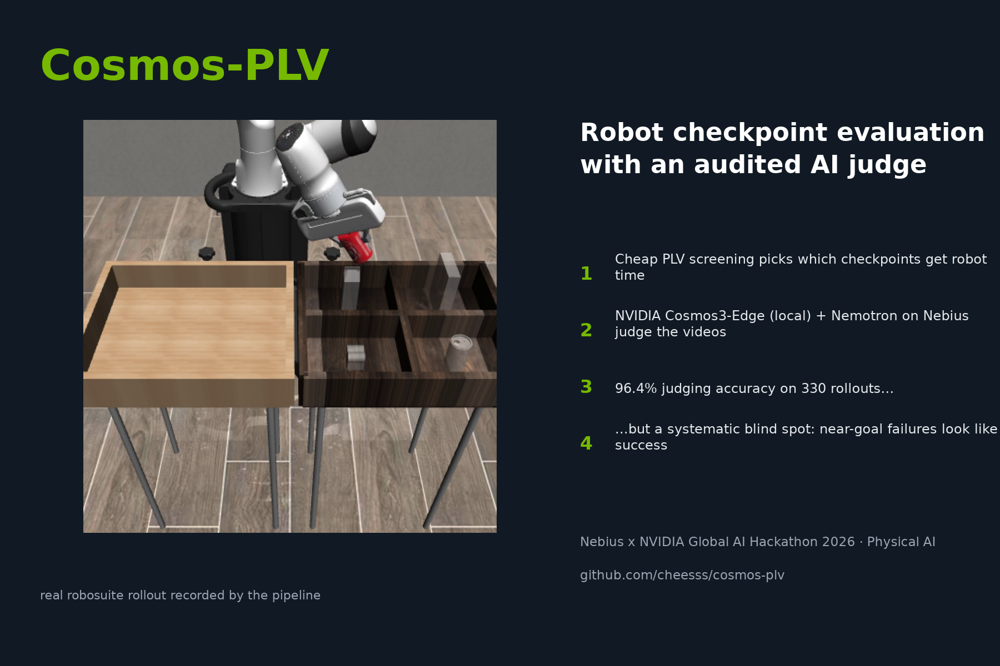

## Results at a glance

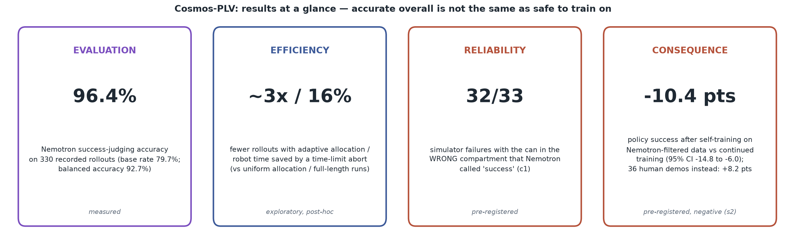

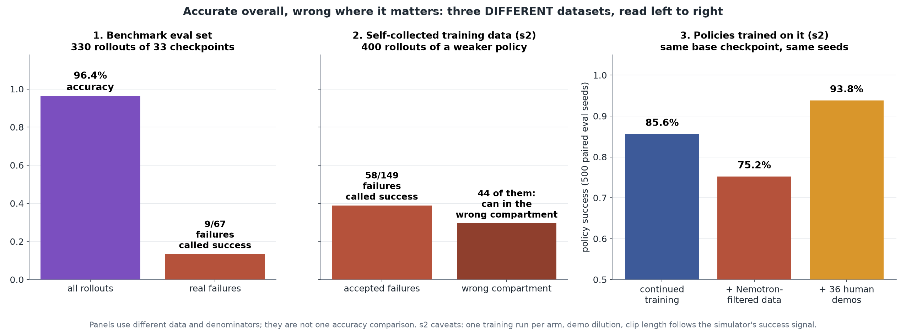

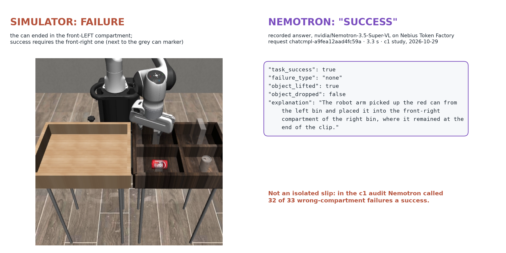

| | result | status |
|---|---|---|
| **Evaluation** | Nemotron judges rollout success with **96.4%** accuracy on 330 recorded rollouts (base rate 79.7%; balanced 92.7%), but still called **9 of 67 failures** a success. Cosmos3-Edge scores 91.8%. Failure *types* are not solved. | measured |
| **Efficiency** | **2–3x fewer rollouts** than uniform allocation to reach excess regret ≤ 0.02 (adaptive allocation; post-hoc simulation on a 56-checkpoint snapshot with simulator labels; the epoch prior, not PLV, does the work). **16% less rollout execution time** (summed simulated robot time over 200 evaluation episodes) with a time-limit abort; 20% if privileged simulator state is used. **16% fewer Nebius calls** with a local-first cascade. These save evaluation effort, not training time. | exploratory, post-hoc |
| **Reliability** | Nemotron called **32 of 33** "can in the wrong compartment" failures a success, and 24 of 33 even when told the compartment. | pre-registered (c1) |
| **Consequence** | Self-training on Nemotron-filtered data **lowered** policy success by **10.4 points** vs continued training (95% CI −14.8 to −6.0). 36 human demos added +8.2. | pre-registered (s2), negative |
| **Honest negative** | No PLV metric beat the free "pick the latest epoch" baseline in these nearly monotone runs. | measured |

**Bottom line: a visual success judge can be accurate overall and still be unsafe as an unverified source of robot-learning labels.**
All numbers trace to result files: [`submission/claim_ledger.csv`](submission/claim_ledger.csv) and [`docs/hackathon/final_claim_audit.md`](docs/hackathon/final_claim_audit.md).

## How it works

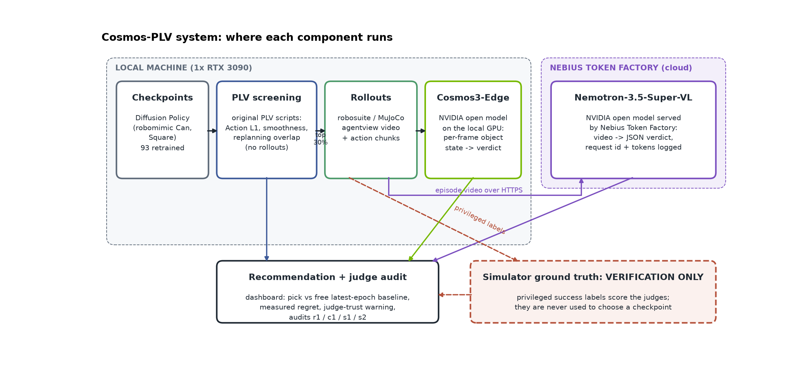

1. **Screen** every checkpoint with the original PLV scripts. This needs no rollouts.
2. **Roll out** the shortlisted checkpoints in robosuite / MuJoCo, recording video, state and every action chunk.
3. **Judge** each rollout video with Cosmos3-Edge (local) and Nemotron (Nebius).
4. **Recommend** what to evaluate next. The free latest-epoch pick and each rule's measured regret are shown next to the recommendation, with a judge-trust warning for strong checkpoints.

Simulator ground truth only scores the judges. It never chooses.

| | |
|---|---|
| 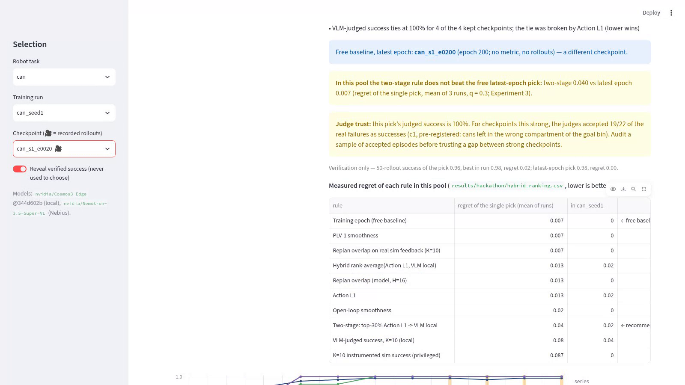 | 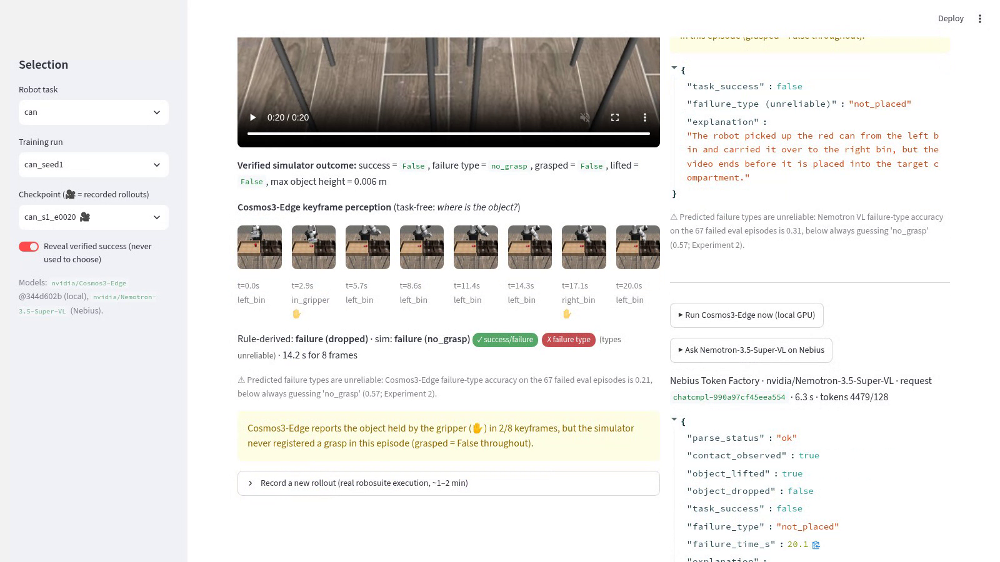 |
| Recommendation with the free baseline and the judge-trust warning | Live Nemotron call on Nebius next to the simulator outcome |
| 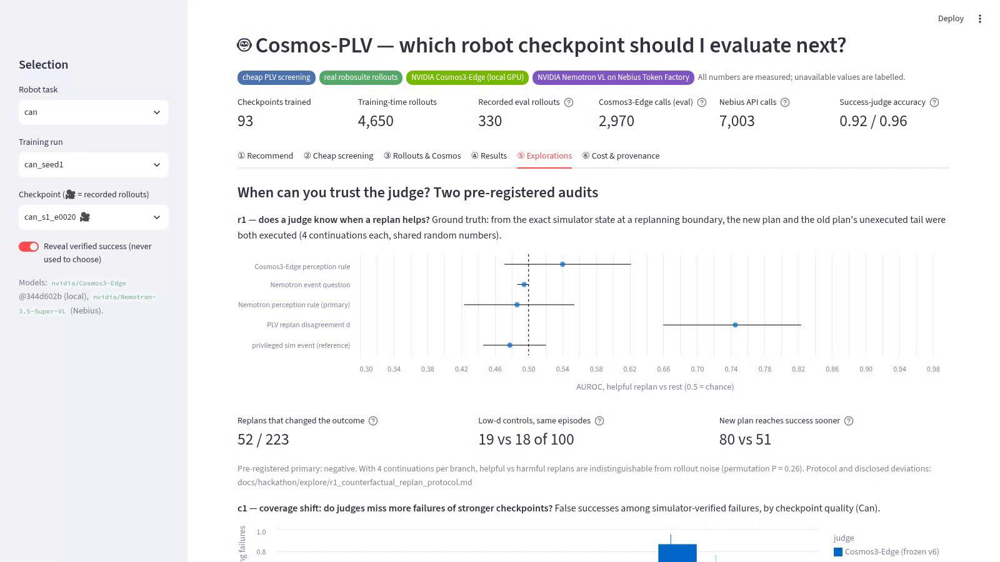 | 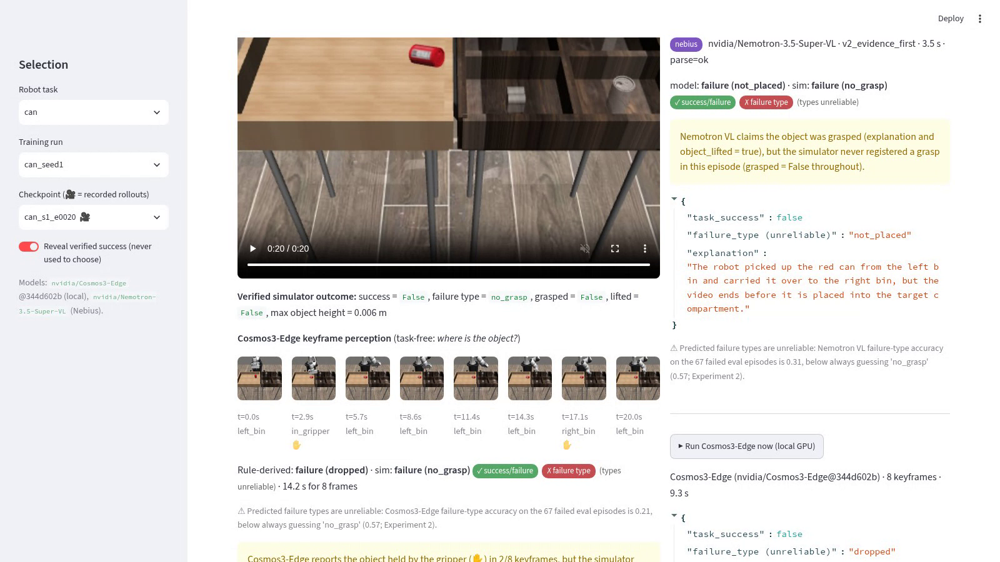 |
| Judge-reliability audits (r1, c1) | Cosmos3-Edge per-keyframe perception (local GPU) |

**Try it:** see [Install](#install), then run the [Smoke test](#smoke-test-one-command-2-min) and the [Demo](#demo-one-command).

## The problem

Low training or validation error does not imply high closed-loop task success.
Teacher-forced validation scores actions on recorded expert observations; at
deployment the policy's own actions change what it sees next. Checkpoints with
similar offline losses can behave very differently on the robot, and every
real evaluation rollout is expensive. Our earlier study ("Cheap Metrics First,
Replanning Diagnostics Second", 1,365 checkpoints, see
[docs/hackathon/08_original_vs_new_work.md](docs/hackathon/08_original_vs_new_work.md))
found that cheap metrics such as Action L1 and open-loop action smoothness are
useful screens, but that a bigger learned dynamics model did not make ranking
more reliable.

The question for this hackathon: **can NVIDIA physical-AI models add useful
diagnostic information beyond cheap offline metrics, at practical cost?**

## Prior work and what is new here

We do not claim the idea of a VLM success judge, a world-model evaluator, chunk-consistency monitoring, active evaluation or self-improvement.
* Each has prior work: SuccessVQA, AutoEval, Sentinel/STAC, VLA-FAIL, Active Offline Policy Selection, SOAR, RoboCat, Large Reward Models, and Guan et al. 2026 on coverage shift.
* Other hackathon projects also use Nemotron and Cosmos to judge rollout videos.

What is new here:
1. The integrated, logged workflow: PLV screen, rollouts, zero-shot NVIDIA judges, recommendation.
2. Measuring the effect on the checkpoint *decision*, against the free baseline.
3. Pre-registered audits of when the judges fail (r1, c1) and of what their errors do to self-training (s1, s2).
4. A same-state audit of a policy's own replans (r1).
5. A zero-shot check of Cosmos3-Edge action conditioning, including untrained action slots in the released checkpoint.

The full list with links is in [docs/hackathon/related_work.md](docs/hackathon/related_work.md). Prior PLV research: [cheesss.github.io/plv-checkpoint-screening](https://cheesss.github.io/plv-checkpoint-screening/). What existed before 2026-08-26 is listed in [docs/hackathon/08_original_vs_new_work.md](docs/hackathon/08_original_vs_new_work.md).

## What the application does

1. **Load a Diffusion Policy checkpoint** and read its execution contract from the
   checkpoint itself (horizon 16, 2 observation steps, 8 executed actions).
2. **Cheap screening** with the original PLV scripts: Action L1 (Level 1),
   open-loop smoothness and PLV-1 model-feedback smoothness (Level 2),
   execution-matched replanning overlap / boundary jump (Level 3).
   Level 3 is a single-sample, per-dimension-normalized relative of the chunk-consistency
   scores used for runtime failure detection (STAC in
   [Sentinel](https://arxiv.org/abs/2410.04640), ACC in
   [VLA-FAIL](https://arxiv.org/abs/2606.21386)). PLV aggregates it offline per checkpoint
   for screening, instead of raising per-episode alarms.
3. **Real rollouts** in robosuite 1.5 (MuJoCo): agentview video, privileged
   simulator state and every predicted action chunk, with verified outcome labels
   (`success`, `no_grasp`, `dropped`, `not_placed`, `other`).
4. **Physical diagnostics** from video:
   * Cosmos3-Edge answers task-free questions about the object ("where is the
     can?"). Success is judged from the last frame. For the failure type, 8 keyframes
     go through a fixed grasp / lift / drop rule.
   * Nemotron-3.5-Super-VL on Nebius watches the episode video and returns a
     schema-validated failure report.
5. **Recommendation**: keep the cheap-metric top 30 %, then rank by VLM-judged
   success of recorded attempts. The free "latest epoch" pick and each rule's
   measured regret are shown next to it. In this pool the two-stage rule does
   **not** beat the epoch pick (Experiment 3), so the app says so. Verified
   simulator success is shown separately and is never used to choose.

Everything is traceable: checkpoint sha256, env seed, diffusion sampling seed,
model id + revision, Nebius request id, latency and token usage.

## NVIDIA and Nebius usage (exact)

**Where Nebius Token Factory helped:**
* It gave us a second, stronger judge without a second GPU. The local RTX 3090 was busy with training, rollouts and Cosmos3-Edge.
* Nemotron-3.5-Super-VL judged each 20-second rollout video in about 3 s through the standard OpenAI client, with several requests in parallel.
* That is how we could re-judge hundreds of rollouts per audit: 620 videos for c1, 400 each for s1 and s2, and 2,000 calls across r1's four judge variants.
* Over 7,000 calls we saw 0 API errors, for an estimated cost of about $5 at list price.

| Component | What | Where it runs | Purpose |
|---|---|---|---|
| `nvidia/Cosmos3-Edge` rev `344d602b128d1bbdacb43b08d0a3626f46343e29` (OpenMDW-1.1) | Reasoner tower, bf16, Transformers 5.21 | local RTX 3090 | per-keyframe physical state of the manipulated object |
| `nvidia/Nemotron-3.5-Super-VL` (OpenMDW-1.1) | OpenAI-compatible chat completions with `video_url` | **Nebius Token Factory** (`api.tokenfactory.nebius.com`) | video-level failure diagnosis (second opinion) |

Runtime evidence of every Nebius call (no secrets): `results/hackathon/nebius_calls.jsonl`,
summary in [docs/hackathon/05_nebius_execution.md](docs/hackathon/05_nebius_execution.md).
Why Cosmos is not called through Nebius: no Cosmos model is served on Token
Factory (catalog checked 2026-10-29); see
[docs/hackathon/04_cosmos_integration.md](docs/hackathon/04_cosmos_integration.md).

## Results

All numbers are measured on this machine; details and CIs in
[docs/hackathon/07_experiment_results.md](docs/hackathon/07_experiment_results.md).
Demo video: `media/hackathon/demo.mp4` (2 min 45 s, English narration and subtitles; the dashboard clips are real screen recordings).

**Pool.** 93 retrained Diffusion Policy checkpoints (Can PH seeds 1 and 2, Square
PH seed 1), each with 50 training-time simulator rollouts (4,650 rollouts), plus
330 recorded evaluation rollouts with video (33 checkpoints x 10 seeds).

**Experiment 1 — cheap metrics (original PLV scripts) vs verified success**, mean
within-run Spearman over 3 runs:

| training epoch (free baseline) | replan overlap | open-loop smoothness | boundary jump | Action L1 | PLV-1 | validation loss |
|---|---|---|---|---|---|---|
| **0.815** | 0.801 | 0.788 | 0.782 | 0.772 | 0.759 | −0.481 |

* Every PLV-family metric keeps a near-best checkpoint in its top 30% (Regret@30 0.007).
* Validation loss is anti-correlated with closed-loop success, which reproduces
  the paper's motivation.
* **No PLV metric beats the free "later epoch is better" baseline in these short,
  nearly monotone runs.** Replanning disagreement falls almost monotonically with
  training (ρ with epoch 0.96–1.00).

**Experiment 2 — can an NVIDIA VLM tell success from failure in a real rollout video?**
(330 episodes, privileged simulator labels as ground truth, prompts frozen on a
separate dev split)

| judge | accuracy [95% CI] | balanced | latency |
|---|---|---|---|
| NVIDIA Cosmos3-Edge, local RTX 3090 (last-frame perception) | 0.918 [0.884, 0.943] | 0.832 | 2.1 s |
| NVIDIA Nemotron-3.5-Super-VL via **Nebius Token Factory** (video) | 0.964 [0.938, 0.979] | 0.927 | 3.1 s |
| same, length-neutral clips (robustness) | 0.961 [0.934, 0.977] | 0.909 | 3.6 s |

* The two judges agree on 94% of episodes, and are 97% accurate when they agree.
* Failure *types* (no grasp / dropped / not placed) are **not** solved: both judges
  score below a majority-class baseline.
* Misses include cans dropped into the wrong compartment of the right bin.

**Experiment 3 — hybrid screening.**
* Scores from 10 extra rollouts rank near-equal checkpoints worse than the free
  cheap scores (pick regret 0.06–0.09 vs 0.007). This holds whether success comes
  from the simulator or from a VLM.
* VLM-judged rollouts are as good as privileged simulator labels. So the visual
  judge can stand in for a success detector where none exists, such as on a real
  robot.

**Exploratory follow-ups** (post-hoc; all except the simple cascade rule were checked by an independent verifier;
[docs/hackathon/11_explorations.md](docs/hackathon/11_explorations.md)):
* adaptive rollout allocation needs about 2–3x fewer rollouts than uniform on this pool (the idea follows
  active policy evaluation such as [AOPS](https://arxiv.org/abs/2106.10251));
* a time-limit early abort saves 16% of robot time at 2/141 false aborts (20% if privileged simulator state is also used);
* a local-first cascade (accept local Cosmos failures, ask Nemotron otherwise) uses 16% fewer Nebius calls
  at a small accuracy cost (0.952 vs 0.964; missed successes 3 → 8);
* camera placement matters, image quality does not;
* LLM-written reports were not reliable, so the app shows only measured values.

**Experiment 4 — Cosmos world model (exploratory).**
* Our first run went through Cosmos3-Edge's `libero` action slot, which turned out to
  be untrained in the released checkpoint. That run is retracted.
* Through the trained Franka slot, ±x/y/z commands move the generated gripper in a
  consistent direction per axis.
* On 15 clips from recorded policy rollouts, the action-dependent part of the generated
  motion points along the true motion (cos 0.78–0.85).
* Can is strong. Square is weak: its end-point error is worse than with no actions.
* Motion is compressed to about 0.4x, the evidence covers only 5 initial states, and
  pixel fidelity is no better than a frozen frame.
* So it cannot yet replace rollouts. Details:
  [07 §C3](docs/hackathon/07_experiment_results.md),
  [04](docs/hackathon/04_cosmos_integration.md).

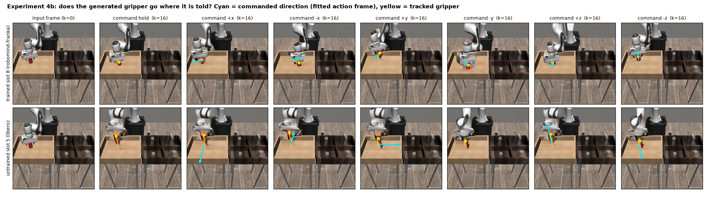

### Judge-reliability audits (pre-registered; amendments and deviations disclosed)

| study | question | result |
|---|---|---|
| [r1](docs/hackathon/explore/r1_counterfactual_replan_protocol.md) | From the exact simulator state, does executing the new plan instead of the old plan's tail help, and can a judge tell? | Primary **negative**. Judges at chance (about 0.49 on undecided boundaries). PLV disagreement flags fragile episodes, not the replan that mattered: low-disagreement controls changed the outcome as often (19 vs 18 of 100). One robust effect: the new plan reaches success sooner (80 vs 51, p = 0.014). |
| [c1](docs/hackathon/explore/c1_coverage_shift_protocol.md) | Do judges miss more failures of stronger checkpoints? | Positive under the pre-registered rule, but fragile: false successes rose 6/25, 14/27, 13/22; the seed-cluster CI includes 0.5. Mechanism: no-grasp failures (always caught) vanish with quality, while failures ending at the goal bin are accepted (32/33 in the wrong compartment). |
| [s1](docs/hackathon/explore/s1_self_improve_protocol.md) | Can judged self-successes lift a plateaued policy (0.885)? | **Null** for every data source, including simulator labels. No bug found. |
| [s2](docs/hackathon/explore/s2_self_improve_protocol.md) | Same question, redesigned: weaker base, human-demo positive control, 500 paired seeds | Human demos **+8.2** [+5.2, +11.4]. Own successes with simulator labels −3.2 [−7.0, +0.6]. Nemotron-filtered **−10.4** [−14.8, −6.0]: Nemotron accepted 58/149 failures, 44 of them in the wrong compartment. Caveats: one run per arm, dilution of the original demos, clip length follows the simulator's success signal. |

Details are in [07 §C4–C5](docs/hackathon/07_experiment_results.md) and the protocols. 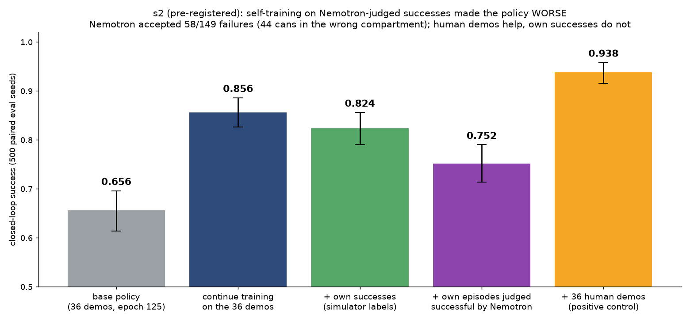

## Scientific limitations

* **Scope.** Simulation only: robomimic Can and Square, three short training runs, one main camera. The 1,365-checkpoint PLV paper study was not re-run.
* **Zero-shot judges.** We tested one simulator and one robot. Accuracy figures are for this evaluation set, not real-world generalization.
* **Exploratory efficiency results.** These are post-hoc analyses of logged rollouts and were not pre-registered.
* **Pre-registered audits.** Each has disclosed amendments and deviations, including an interim look in r1. s2 trains one run per arm.
* **Cost.** The figure is an estimate from logged tokens at list price, not billing.

## Install

Tested on Ubuntu 20.04, 1x RTX 3090 (24 GB), NVIDIA driver 570 (CUDA 12.8).
Isolated environments are used (the PLV stack and the Cosmos stack have
incompatible dependencies); they exchange MP4 / NPZ / JSON files. Environment C
is needed only for the exploratory world-model experiment.

```bash
git clone https://github.com/cheesss/cosmos-plv.git && cd cosmos-plv

# Environment A (PLV: training, metrics, robosuite rollouts) — Python 3.10
conda env create -f conda_environment.yaml   # original definition; or reuse an env matching
pip install -e .                              # configs/hackathon/requirements-plv-lock.txt
source scripts/hackathon/env.sh               # sets MUJOCO_GL=egl, LD_PRELOAD libffi fix, W&B offline

# Environment B (Cosmos + Nebius client + dashboard) — Python 3.11
python3.11 -m venv ~/.venvs/cosmos-plv
~/.venvs/cosmos-plv/bin/pip install torch==2.8.0 torchvision==0.23.0 --index-url https://download.pytorch.org/whl/cu128
~/.venvs/cosmos-plv/bin/pip install -r requirements-cosmos.txt
source scripts/hackathon/envb.sh

# Environment C (Cosmos3-Edge generator: action-conditioned forward dynamics, exploratory
# Experiment 4) — Python 3.12, diffusers main pinned to the commit in the lock file
python3.12 -m venv ~/.venvs/cosmos-gen
~/.venvs/cosmos-gen/bin/pip install -r configs/hackathon/requirements-cosmos-gen-lock.txt \
    --extra-index-url https://download.pytorch.org/whl/cu128

# Nebius Token Factory key (never commit it)
mkdir -p ~/.config/cosmos-plv && cp .env.example ~/.config/cosmos-plv/nebius.env  # then fill NEBIUS_API_KEY
```

## Data and checkpoints

```bash
bash scripts/hackathon/download_datasets.sh          # robomimic v1.5 can/square PH, pinned revision + sha256
bash scripts/hackathon/train_checkpoint_pool.sh      # 3 runs with the ORIGINAL DP training script
python scripts/hackathon/make_pool_manifest.py       # results/hackathon/checkpoint_manifest.{csv,json}
```

The original paper checkpoints no longer exist (deleted 2026-09-28), so a reduced
pool was retrained: Can PH seeds 1 and 2, Square PH seed 1, a checkpoint every
5–10 epochs, each with 50 simulator rollouts on seeds 100000–100049 (the
repository's own protocol). See
[docs/hackathon/03_model_recovery.md](docs/hackathon/03_model_recovery.md).

## Smoke test (one command, ~2 min)

```bash
bash scripts/hackathon/smoke_test.sh
```

Runs the unit tests in both environments, a 1-step DP training smoke run, one
recorded rollout, one Cosmos3-Edge call and (if a key is configured) one Nebius
call.

## Demo (one command)

```bash
source scripts/hackathon/envb.sh && streamlit run dashboard/app.py
```

The six tabs:
1. **Recommend**: the evaluate-next answer, the free latest-epoch baseline, measured regret and the judge-trust warning.
2. **Cheap screening**: re-runs the original metric script live.
3. **Rollouts & Cosmos**: real rollout videos, recording a new rollout, Cosmos3-Edge live, Nemotron on Nebius live.
4. **Results**: Experiments 1–3.
5. **Explorations**: the judge-reliability audits and every exploratory study.
6. **Cost & provenance**: every logged Nebius call.

Live buttons need the checkpoint pool, the local Cosmos weights or a Nebius key. Without them the app shows the recorded outputs and labels them as recorded.

## Reproduce the experiments

```bash
bash scripts/hackathon/compute_baseline_metrics.sh            # Experiment 1 (original scripts, paper flags)
python scripts/hackathon/analyze_baseline.py                  # -> results/hackathon/baseline_*.csv
python scripts/hackathon/record_eval_set.py --wait-for-pool   # 10 eval rollouts per eval checkpoint
python scripts/hackathon/run_cosmos_diagnostics.py --rollouts data/outputs/hackathon_rollouts_eval \
    --variant v7_perception_track --no-reasoning --keyframes 8 --out data/outputs/hackathon_cosmos/eval_local_v7.jsonl
python scripts/hackathon/run_cosmos_diagnostics.py --rollouts data/outputs/hackathon_rollouts_eval \
    --backend nebius --variant v2_evidence_first --no-reasoning --max-new-tokens 700 \
    --out data/outputs/hackathon_cosmos/eval_nebius_v2.jsonl
python scripts/hackathon/analyze_hybrid.py                    # Experiments 2 + 3
python scripts/hackathon/make_figures.py                      # media/hackathon/*.png
```

The protocol (splits, seeds, prompt-selection rule) was written before any
evaluation episode was scored: [docs/hackathon/06_experiment_protocol.md](docs/hackathon/06_experiment_protocol.md).

## Repository layout (hackathon additions)

```
cosmos_plv/            integration package (stages A-F)
scripts/hackathon/     setup, training, recording, diagnostics, analysis, figures, demo
dashboard/app.py       Streamlit application
tests/hackathon/       unit tests (no GPU needed)
docs/hackathon/        00-10 audit, protocol, results, status
results/hackathon/     machine-readable results (CSV / JSON / JSONL)
media/hackathon/       figures and demo video
configs/hackathon/     dataset manifest, environment locks
```

## Hardware requirements

* Training + rollouts: one CUDA GPU (we used an RTX 3090; each DP lowdim run
  needs ~2.3 GB) and a multi-core CPU (robosuite rollouts are CPU-bound).
* Cosmos3-Edge Reasoner: ~5 GB GPU memory for single images, ~8.4 GB peak
  for a 20 s video, bf16 (Ampere or newer).
* Nebius: an API key; no local GPU needed for that backend.

## License and attribution

* Code in this repository: MIT (see `LICENSE`; upstream Diffusion Policy
  © 2023 Columbia AI and Robotics Lab). The hackathon additions are released
  under the same MIT terms.
* Bundled third-party code keeps its own licenses and notices (Apache-2.0, MIT,
  BSD-3-Clause), listed in [`NOTICE`](NOTICE). Dependencies (robomimic, robosuite,
  MuJoCo) are installed by pip under their own licenses, and the robomimic datasets
  are downloaded rather than redistributed.
* Model weights are not redistributed. `nvidia/Cosmos3-Edge` and
  `nvidia/Nemotron-3.5-Super-VL` are used under OpenMDW-1.1 as published by NVIDIA.
* Research: Hyun Joon Cho and Taehwan Yun, Sungkyunkwan University. Please cite
  Diffusion Policy (Chi et al., RSS 2023) and robomimic (Mandlekar et al., CoRL 2021).
