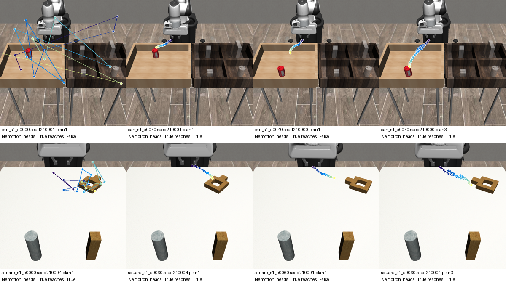

# x6 — Visual plan critic (rollout-free VLM judgement of the policy's own plan)

**Status: EXPLORATORY / post-hoc.** Run on 2026-10-29, 04:44–05:40 KST. It used the checkpoint pool as it
stood then (51 checkpoints, training still running). Every number below comes from
`results/hackathon/explore/x6_visual_plan_critic.json`, which `x6_analyze.py` produced, unless another file is
named.

**Result: negative.** Asking Nemotron-3.5-Super-VL to judge the policy's predicted plan, drawn on the initial
camera image, does not help checkpoint screening in this pool. It adds nothing over a geometric score that is
computed directly from the plan with no VLM. Both are beaten by the free baseline "later epoch = better".

*Clean overlays with the Nemotron verdicts. Top row: can. Bottom row: square. Epoch-0 plans are random
scribbles but are still judged `heads=True`, and on square also `reaches=True`. For a trained checkpoint, the
verdict changes with the scene (env seed), not with the checkpoint.*

## 1. Question

Can a vision-language model judge the policy's **own predicted 16-step plan**, drawn on the initial agentview
image? The question asked is task-free: "will this planned motion bring the gripper close to the object?". It
needs no rollout and no action-conditioned world model. The resulting fraction of positive verdicts per
checkpoint should rank checkpoints by closed-loop success. It should also beat a purely geometric score taken
from the same plan.

## 2. Why it could help PLV or efficiency

PLV ranks checkpoints by properties of the **policy-induced trajectory**. A rendered plan is the cheapest
visual form of that trajectory. Per checkpoint it costs one env reset, one policy call and one VLM call per
seed, and no closed-loop rollout. If a VLM could read "plan quality" from the picture, it would be a
rollout-free visual PLV signal. It could also screen out bad checkpoints before expensive simulator
evaluation.

## 3. Method

* **Checkpoints:** all 51 in `data/outputs/hackathon_pool` at run time: `can_s1` 20 (epochs 0–95, every 5),
  `can_s2` 16 (epochs 0–150, every 10) and `square_s1` 15 (epochs 0–140, every 10).
* **Env seeds:** 210000–210004 (K=5). These are disjoint from the eval seeds 200000–200009, the dev seeds
  300000+ and the training-time test seeds 100000–100049. The diffusion sampling seed equals the env seed, so
  every checkpoint gets the same noise for the same scene (common random numbers).
* **Plan (Env A, `x6_plan_render.py`):** `env.seed(s); env.reset()`, obs history = 2 copies of the first obs.
  One `policy.predict_action` call is made with the checkpoint's own config (100 DDPM steps); its
  `action_pred` (16×10) contains absolute world-frame EEF targets.
  * **Variant A (`plan1`)** uses this first call only.
  * **Variant B (`plan3`)** is a short **real** closed-loop rollout of 3 chunks (24 sim steps). All 3 predicted
    chunks are drawn on the initial frame. It was run only for the eval-epoch checkpoints (can every 20 epochs,
    square every 30), 18 checkpoints.
* **Projection:** `robosuite.utils.camera_utils.get_camera_transform_matrix(sim, 'agentview', 448, 448)`.
  Debug images confirm that the projected current EEF lands on the gripper and the projected object position
  lands on the can or nut, with **no** row flip: robomimic's `[::-1]` render already matches robosuite's pixel
  rows. Debug images:
  `data/outputs/hackathon_explore/x6_visual_plan_critic/plans/debug_projection_{can,square}_*.png`.
  The plan is drawn as dots and a line from dark purple (now) to light yellow (last point). Red is avoided
  because the can is red.
* **Rendering incident and fix (`x6_redraw.py`):** the render process reused one offscreen env per task for
  all checkpoints. After the first checkpoint its frames were corrupted (magenta noise) or **vertically
  flipped**, even though `eef0`, `obj0` and the camera matrix were bit-identical (checked, max diff 0). The
  geometry is unaffected. The initial state for a seed is the same for every checkpoint, so every overlay was
  redrawn on the first-rendered, validated frame of that seed (`can_s1_e0000` and `square_s1_e0000`). The
  script asserts state equality before drawing. Redrawn overlays for the two reference checkpoints are
  pixel-identical to the originals (max diff 0).
* **VLM (Env B, `x6_vlm_judge.py`):** Nemotron-3.5-Super-VL via `NebiusVLMClient` (no reasoning,
  max_tokens 300, temperature 0.2). The prompt is task-free: "The coloured dots … show where the robot gripper
  plans to move next (from dark to light) … Will this planned motion bring the gripper close to {the red can |
  the square nut}?" It returns JSON `{heads_to_object, reaches_object, explanation}`.
  * **Control (`raw`):** the same frame without dots, asking whether the gripper is *currently* close
    (10 calls).
  * **Cosmos3-Edge:** prepared (`x6_run_cosmos.sh`, flock + 0.25 GPU fraction, batch 1) but not run, see §5.4.
* **Geometric baselines (no VLM), from the same plan:**
  * min / end 3D distance from the plan to the object (m);
  * min 2D pixel distance from the projected plan to the object pixel;
  * `geo_heads` = the plan end is ≥ 2 cm closer than the start;
  * `geo_reach` = min distance < 5 cm;
  * plan jitter (mean ‖Δ²pos‖).

  The thresholds were fixed before looking at outcomes.
* **Other context baselines:** `val_loss` from the training log, and `epoch` ("later = better", free).
* **Targets and splits:** training-time per-episode success from `logs.json.txt`.
  * **Half B** (seeds 100025–100049, 25 episodes) is the held-out report target.
  * **Half A** (100000–100024) is shown only for transparency.
  * Secondary target: recorded eval-rollout success (`hackathon_rollouts_eval`, 5–8 checkpoints per run).

  No score is fitted. Every metric's direction is fixed a priori: VLM fraction and `geo_heads` higher = better,
  distances, jitter and val_loss lower = better. Statistics are within-run oriented Spearman with a 2000×
  percentile bootstrap over checkpoints (`cosmos_plv.ranking`) and Regret@30. Regret is given both with the
  paper's path tie-break and as the expectation over random tie orders, because the VLM scores have only 1–3
  distinct values per run and the path tie-break favours early epochs. Wilson CIs are used for per-image
  rates.
* **Selection regime:** besides all epochs, results are repeated on **epoch ≥ 20**, where the trivially bad
  early checkpoints are gone and selection actually matters. This split was declared before the results were
  examined.

## 4. Commands run (cwd `/path/to/repo`)

| # | Command | Exit |
|---|---|---|
| 1 | `flock /tmp/claude-1000/gpu_explore.lock bash -lc 'source scripts/hackathon/env.sh && python scripts/hackathon/explore/x6_plan_render.py --filter can_s1_e0040 --out data/outputs/hackathon_explore/x6_visual_plan_critic/smoke'` (smoke; revealed the row-flip question) | 0 |
| 2 | `scripts/hackathon/explore/x6_run_render.sh` (GPU-free check ≥ 9000 MiB, then flock + Env A; log `data/outputs/hackathon_explore/x6_visual_plan_critic/render_run1.log`) | 0 |
| 3 | `PYTHONNOUSERSITE=1 ~/.venvs/cosmos-plv/bin/python scripts/hackathon/explore/x6_redraw.py` (run 5×, incremental) | 0 |
| 4 | `PYTHONNOUSERSITE=1 HF_HUB_OFFLINE=1 ~/.venvs/cosmos-plv/bin/python scripts/hackathon/explore/x6_vlm_judge.py --backend nebius --variants {plan1,plan3,raw} …` (9 incremental invocations, `--workers 4`), plus `--variants plan1_rep --ids can_s1_e0040,can_s2_e0080,square_s1_e0060,square_s1_e0120 --max-calls 20` (test-retest) | 0 (all) |
| 5 | `scripts/hackathon/explore/x6_run_cosmos.sh --variants plan1 --max-calls 260` (log `…/cosmos_run1.log`) | not finished: queued on the GPU lock (§5.4) |
| 6 | `PYTHONNOUSERSITE=1 ~/.venvs/cosmos-plv/bin/python scripts/hackathon/explore/x6_analyze.py` | 0 |

**Nebius usage:** 400 calls tagged `explore/x6_visual_plan_critic/…` in
`results/hackathon/explore/nebius_calls_explore.jsonl` (the self-imposed cap; task limit 400).
* 375 are used in the analysis: 255 plan1, 90 plan3, 10 raw and 20 plan1 test-retest repeats. All 375 parsed
  `ok`.
* 25 calls are excluded because they were made on the corrupted or flipped frames before the incident was
  found: `can_s2_e0000` (15) and `can_s1_e0020` (10). They are kept in
  `data/outputs/hackathon_explore/x6_visual_plan_critic/vlm_nebius.jsonl`.
* The analysed rows are in `vlm_nebius_clean.jsonl`. 30 of them were carried over from `vlm_nebius.jsonl`
  because their images are pixel-identical.

## 5. Results

### 5.1 Ranking vs held-out training success (half B), within run

Oriented Spearman with a bootstrap 95% CI. `u` = number of distinct metric values among the run's
checkpoints. R@30r = Regret@30 with random tie-break.

| metric (direction) | can_s1 (n=20) | can_s2 (n=16) | square_s1 (n=15) |
|---|---|---|---|
| **epoch** (free baseline, higher better) | **+0.94** [+0.81,+0.99] | **+0.87** [+0.57,+0.98] | **+0.85** [+0.56,+0.97] |
| VLM plan1 `heads` frac (↑) | +0.38 [−0.12,+0.77] u=3 | +0.34 [−0.12,+0.80] u=3 | undefined (u=1, all 1.0) |
| VLM plan1 `reaches` frac (↑) | −0.55 [−0.89,+0.04] | −0.67 [−0.91,−0.28] | −0.19 [−0.72,+0.44] |
| geometric `heads` frac, no VLM (↑) | +0.53 [+0.38,+0.77] u=3 | +0.44 [+0.43,+0.77] u=2 | +0.60 [+0.44,+0.85] u=3 |
| geometric min 3D dist (↓) | −0.40 [−0.96,+0.20] | −0.51 [−0.96,+0.17] | +0.46 [−0.05,+0.77] |
| geometric min pixel dist (↓) | −0.68 [−0.97,−0.18] | −0.51 [−0.96,+0.17] | −0.77 [−0.93,−0.41] |
| plan jitter (↓) | +0.47 [+0.06,+0.76] | +0.06 [−0.56,+0.62] | −0.39 [−0.89,+0.27] |
| val_loss (↓) | +0.35 [−0.21,+0.77] | −0.16 [−0.74,+0.44] | +0.06 [−0.58,+0.62] |

Regret@30 is uninformative here, because success saturates. Random ranking already gives an expected
R@30 of 0.018 / 0.002 / 0.034 on half B. VLM plan1 heads gets 0.000 / 0.000 / 0.034, geometric heads
0.014 / 0.001 / 0.029, and epoch 0.000 / 0.000 / 0.000.

**Variant B (`plan3`, 3 real chunks, 18 eval-epoch checkpoints, n=5/8/5):** `heads` gives +0.71 / +0.60 /
undefined and `reaches` gives +0.22 / +0.09 / +0.73. Both are driven entirely by epoch 0: the `heads` rate is
0.30 for can epoch 0 (Wilson [0.11, 0.60], n=10) and 1.00 for can epoch ≥ 20 (Wilson [0.93, 1.00], n=55).

### 5.2 Selection regime (epoch ≥ 20, half B)

| metric | can_s1 (n=16) | can_s2 (n=14) | square_s1 (n=13) | Spearman with **epoch** (same subset) |
|---|---|---|---|---|
| epoch | +0.89 [+0.65,+0.98] | +0.80 [+0.39,+0.97] | +0.77 [+0.39,+0.94] | 1, 1, 1 |
| VLM plan1 heads | +0.53 [−0.03,+0.91] | +0.63 [+0.03,+0.93] | undefined | +0.40, +0.68, — |
| VLM plan1 reaches | −0.82 [−0.91,−0.63] | −0.82 [−0.96,−0.52] | −0.47 [−0.84,−0.09] | −0.86, −0.78, −0.73 |
| geo heads | undefined (all 1.0) | undefined | undefined | — |
| geo min 3D dist | −0.91 [−0.98,−0.71] | −0.82 [−0.97,−0.45] | +0.33 [−0.24,+0.71] | −0.98, −0.96, +0.16 |
| val_loss | −0.29 [−0.71,+0.37] | −0.60 [−0.89,−0.11] | −0.45 [−0.76,+0.14] | −0.35, −0.89, −0.64 |

Among trained can checkpoints, the first plan becomes **more conservative** as training proceeds. The mean min
distance to the can rises from 0.114–0.115 m at epoch 20 to 0.128–0.131 m at the end (`per_checkpoint`), while
success also rises. "Closer = better" is therefore strongly anti-correlated with success. The sign is
opposite on square, so it cannot be fixed by flipping the direction post hoc. The VLM metrics follow the same
epoch drift: their correlation with epoch is about as large as their correlation with success. Here they are
proxies for training progress, which `epoch` provides for free and better.

### 5.3 Does the VLM add anything over geometry? (per image, Nemotron plan1, n=255)

* **`reaches` tracks plan distance.** Nemotron's `reaches` verdict is predicted by the plan's 3D min
  distance with AUC **0.975**, and by the 2D pixel distance with AUC 0.89. It is a thresholded distance,
  looser than the a-priori 5 cm: VLM reaches rate 0.416 vs geometric 0.063. Every image with geometric
  reach < 5 cm was judged `reaches`. At checkpoint level, the VLM reaches fraction vs geometric min distance
  gives Spearman +0.72 / +0.80 / +0.31.
* **`heads` does not follow the 3D geometry.** Agreement with `geo_heads` is 0.79 but kappa is **0.04**.
  The AUC against 3D progress (start − end distance) is 0.30, below chance. The VLM says "moves away" for
  many trained plans that do approach the object in 3D. This happens mainly on can seeds 210000 and 210004,
  where the plan curves away in 2D. It also says `heads=True` for 0.7 of the random epoch-0 can plans
  (Wilson [0.40, 0.89], n=10) and for 1.0 of the square ones (n=5).
* **The verdict is about the scene, not the checkpoint.** On epoch ≥ 20 images (n=215), the env seed
  explains η² = **0.82** of the variance of `reaches`, against a chance level of 0.04. The checkpoint explains
  0.24, against a chance level of 0.20. For `heads` the figures are 0.50 by seed and 0.17 by checkpoint.
* **It is repeatable, so the scene effect is systematic.** 20 independent repeat calls on trained-checkpoint
  plan1 images (4 checkpoints × 5 seeds) agree with the first call on `heads` 19/20 (0.95, Wilson
  [0.76, 0.99]) and on `reaches` 20/20 (1.00, Wilson [0.84, 1.00]). The dominance of the seed is not sampling
  noise.
* **Raw-frame control (no dots).** Asked whether the gripper is currently close, Nemotron answered
  `reaches=False` on 10/10 frames, which is correct: the start distance is 0.18–0.33 m. So the `reaches=True`
  verdicts on overlays are induced by the drawn dots.
* **Variant B (plan3, n=90).** Agreement with the 3-chunk geometric `heads` is 0.91 (kappa 0.51), with AUC
  0.97 against 3D progress. Longer plans are easier to read, but on trained checkpoints they are uniformly
  positive: heads 1.0, reaches 0.91 on can and 1.0 on square.

### 5.4 Cosmos3-Edge

Not run within the time box. The launcher (`x6_run_cosmos.sh`) polled `nvidia-smi` free memory every ~60 s.
Free memory stayed at 1438–4480 MiB from 05:08 to about 05:20 KST
(`data/outputs/hackathon_explore/x6_visual_plan_critic/cosmos_run1.log`). At about 05:21 the free-memory check
passed, and the process then queued on the shared lock `/tmp/claude-1000/gpu_explore.lock`. Another
exploration's Cosmos job (`x5_cosmos_modes.py`, lock acquired 05:08, about 42 min planned) holds that lock. At
05:38 the x6 Cosmos judge had not started, and **no Cosmos rows exist**. The queued job is left as is. It ends
with this session: no process was signalled, and if it ever runs, its rows go to `vlm_local_clean.jsonl`,
which `x6_analyze.py` picks up automatically. Given §5.3, a second VLM is unlikely to change the conclusion:
the limited information in one initial plan and the dominance of the scene are model-independent.

### 5.5 Cost per checkpoint

These are means from the run on the shared, 100%-utilised RTX 3090:

* policy load: 1.66 s;
* reset + render: 0.06 s per seed (the first reset of a seed is about 0.8 s, then it is cached);
* one 100-step DDPM policy call: 2.37 s per seed;
* one Nemotron call: 2.88 s.

With K=5 seeds this is about 13.8 s without the VLM, plus about 14.4 s of sequential VLM latency (it can run
in parallel), so about 28 s per checkpoint. For comparison, recorded closed-loop eval costs about 16.6 s of
amortised wall time per episode (`batch_wall_s / n_episodes`, batched envs). The probe is cheap. It is not
informative.

## 6. Interpretation

1. **The only real signal is "random policy vs trained policy".** Epoch 0 and, for can, some epoch-5 plans
   are random scribbles. The geometric `heads` test catches them perfectly. The VLM catches them only
   partially: it calls 70% of random can plans and 100% of random square plans "heading to the object".
   Every metric, including `val_loss`, already separates these checkpoints.
2. **Among trained checkpoints, one initial plan carries no quality information.** Every trained plan heads
   to the object (geometric heads = 1.0 for all 43 checkpoints with epoch ≥ 20). The residual variation is a
   slow epoch drift with a task-dependent sign. Success differences between trained checkpoints (0.5 → 1.0)
   come from grasping and placing, which the first 0.8 s of motion does not show.
3. **The VLM adds nothing over geometry and is worse.** `reaches` is a fuzzy distance threshold (AUC 0.975
   against 3D distance). `heads` is noisier than the 3D test and is dominated by how the path looks in 2D for
   a given scene. Following the task's own criterion, the VLM adds nothing.
4. For PLV this supports the existing design: informative policy-induced signals need the trajectory under
   **feedback**, such as replanning overlap and boundary jump on real rollouts, not one open-loop look at the
   initial plan.

## 7. Limitations

* There are 3 runs and only 13–20 checkpoints per run. Success saturates near 1.0 for can, so Regret@30 cannot
  discriminate, and CIs are wide.
* K=5 env seeds. The VLM score has only 1–3 distinct values per run.
* Training was still running. The epoch baseline is strong only because success has risen roughly
  monotonically so far. It would weaken with overfitting or late collapse, which this pool does not show yet.
* The 3D plan was projected to 2D from one camera, so depth (height above the object) is invisible to the VLM.
  This is a deliberate part of the probe, but it caps what any VLM can read. A second camera view was not
  tried.
* One prompt and one model (Nemotron, no reasoning) were used. Cosmos3-Edge was not run (GPU busy). There was
  no prompt development on the dev split. Variant B covered only 18 eval-epoch checkpoints.
* Rendering-incident workaround: overlays are redrawn on reference frames. This is valid only because the
  initial state per seed is identical across checkpoints, which the script asserts.
* 25 Nebius calls were made on corrupted or flipped frames and are excluded.

## 8. What to try next

* Skip VLM plan critics for screening trained checkpoints. If anything, keep the geometric "plan heads to
  object" check as a free sanity gate for untrained or broken checkpoints. It needs no VLM and no rendering.
* If a visual plan signal is still wanted, it must look at later phases. Possible ways:
  * render the plan at the **pre-grasp and transport** moments of a short real rollout, for example at the
    first gripper close, and ask whether it ends in the target bin or on the peg;
  * contrast plans from several sampling seeds at the same state (plan multimodality);
  * use two camera views so depth is visible.
* Re-run on the final pool (`x6_run_render.sh`, then redraw, judge and analyse; all stages are incremental)
  once overfitting or late checkpoints exist. That is where the epoch baseline breaks and a quality signal
  would matter.
* Fix the renderer reuse: create a fresh env per checkpoint, or one process per task. Then the redraw step is
  not needed.

## Files

* Scripts: `scripts/hackathon/explore/x6_plan_render.py`, `x6_run_render.sh`, `x6_redraw.py`,
  `x6_vlm_judge.py`, `x6_run_cosmos.sh`, `x6_analyze.py`.
* Results: `results/hackathon/explore/x6_visual_plan_critic.json`.
* Scratch: `data/outputs/hackathon_explore/x6_visual_plan_critic/`. It contains:
  * `plans/` (npz per checkpoint and seed, original PNGs, debug projections, `render_log.jsonl`);
  * `plans_clean/` (analysed overlays);
  * `vlm_nebius_clean.jsonl` (analysed), `vlm_nebius.jsonl` (includes the excluded calls);
  * `render_run1.log`, `cosmos_run1.log`.
