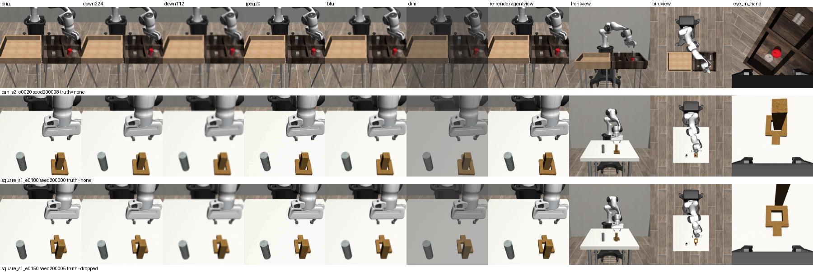

# y3_visual_robustness: how robust is VLM success detection to the camera and to image quality? (EXPLORATORY, post-hoc)

**한국어 요약.** 기록된 실행 action을 다시 재생했더니 결과가 비트 단위로 같았다. 60/60 에피소드에서 eef와 물체 위치 오차가 0.0 m였고 성공 플래그도 모두 일치했다. 그래서 같은 에피소드를 다른 카메라 4개로 다시 렌더링하고, 원래 agentview 영상에는 화질 저하 5종을 적용했다. 고정된 두 judge(Cosmos3-Edge v6 마지막 프레임, Nemotron v2 pad 20.1 s)를 프롬프트를 바꾸지 않고 돌렸다. 결과는 세 가지다. **(1) 화질 저하는 거의 영향이 없다.** 224/112 px 다운스케일, blur, 어둡게(dim)는 모두 |Δacc| ≤ 0.05였다. 가장 큰 손실은 Nemotron JPEG q20의 −0.083 [−0.17, 0.00]이다. **(2) 카메라 위치가 결정적이다.** agentview 재렌더 대비 정확도 변화는 다음과 같다(Cosmos / Nemotron).

| 카메라 | Cosmos3-Edge | Nemotron |
|---|---|---|
| frontview | −0.10 [−0.23, 0.02] | −0.07 [−0.16, 0.04] |
| birdview | −0.17 [−0.34, 0.00] | −0.15 [−0.25, −0.04] |
| eye-in-hand | −0.28 [−0.45, −0.15] | −0.30 [−0.45, −0.18] |

eye-in-hand에서는 두 모델 모두 balanced accuracy가 0.49–0.51, 즉 우연 수준이다. **(3) 실패 양상이 카메라마다 다르다.** frontview/birdview처럼 멀리서 본 화면에서는 square nut이 몇 픽셀밖에 안 된다. 그래서 Cosmos가 실패한 square 에피소드 대부분을 "on_peg"라고 답했다(frontview 16/18, birdview 18/18). eye-in-hand에서는 물체가 카메라와 함께 움직인다. 그래서 Nemotron은 성공한 에피소드의 88%를 "잡지 못함/들지 않음"으로 판정했다(TPR 0.12). 이는 화면 정보가 부족한 탓이기도 하지만, 프롬프트가 "고정된 3인칭 카메라", "로봇 팔이 두 bin 위에 있다"고 설명하는 탓이기도 하다. **권장 사항**: 실제 로봇에서 판정용으로는 물체가 화면을 크게 차지하는 가까운 사선 3인칭 고정 카메라(agentview와 비슷한 배치)를 쓴다. 손목 카메라 단독이나 먼 정면·천장 카메라는 쓰지 않는다. 화질(해상도 224 px 이상, 일반적인 압축)은 병목이 아니다. 새 카메라를 쓸 때는 그 카메라로 dev 프롬프트 선택을 다시 해야 한다. 이번 실험은 사후 탐색이다. 60 에피소드, 22 체크포인트이고 CI가 넓다.

## Question

PLV ships a VLM success judge that was developed and validated on the simulator's `agentview` camera only. On the full eval split, Cosmos3-Edge v6 scores about 0.90 and Nemotron v2 about 0.956. A real robot will not have that camera. How much success-detection accuracy is lost when (a) the same episode is seen from a different camera and (b) the agentview image is degraded (lower resolution, compression, blur, lighting)? Where should the camera go?

This is an **exploratory, post-hoc** study. The prompts, decoding settings and parsers are the frozen ones from `06_experiment_protocol.md`. Nothing was tuned on the outcomes reported here.

## Method

**Episode subset.** `scripts/hackathon/explore/y3_select_episodes.py` picks 60 eval episodes (seeds 200000–200009) by a fixed rule that reads no VLM output. The universe is the 25 checkpoints covered by the frozen eval diagnostics. Episodes are stratified by (task, verified failure type) with these quotas:

| task | none | no_grasp | dropped |
|---|---|---|---|
| can | 12 | 10 | 8 |
| square | 12 | 9 | 9 |

Within a stratum, episodes are taken round-robin over checkpoints, with order set by `sha256("y3|ckpt|seed")`. The result is 60 episodes from 22 checkpoints: 24 successes and 36 failures. After the 05:20 ground-truth fix, no `not_placed` or `other` labels remain in eval. The subset is enriched for failures on purpose, so its absolute accuracies are lower than on the full eval split. On these same 60 episodes the frozen runs score 0.767 (local v6, `eval_local_v6.jsonl`) and 0.850 (Nemotron, `eval_nebius_v2_pad201.jsonl`).

**Step 1, replay determinism** (`y3_replay_render.py`, Env A, one process under `flock`).

- Each env is built exactly as `rollout_recorder._make_env` builds it: `low_dim_abs.hdf5`, the 4 checkpoint obs keys, the absolute OSC controller, `render_offscreen=True`, 448×448.
- Then `env.seed(env_seed); env.reset()`, followed by one `env.step` per row of the npz `action` array (the EXECUTED actions).
- The recorder's privileged probe is sampled after every step and compared with the npz.

**Step 2, re-rendering.** At every step with `t % 2 == 0`, matching the original 10 fps video, the script renders `agentview` (the control), `frontview`, `birdview` and `robot0_eye_in_hand` at 448×448, after making the EGL context current as `_render` does. Each video is written with the recorder's `write_mp4` settings and decoded again. From the decoded video it saves the last frame and 8 keyframes as PNG.

**Step 3, degradations** (`y3_degrade.py`). These are applied to the decoded ORIGINAL agentview frames, with parameters fixed before any judge output was seen:

- `down224` and `down112`: bilinear downscale to that size, then upscale back to 448.
- `jpeg20`: JPEG quality 20.
- `blur`: Gaussian blur, σ = 1.5 px.
- `dim`: brightness ×0.75, then contrast ×0.75.

Every frame is degraded and written as an mp4. The degraded last frame is saved as a PNG. `orig` is the untouched recorded video and last frame.

**Step 4, frozen judges** (`y3_run_judges.py`). The prompts are the same for every camera.

- **Local, Cosmos3-Edge v6.** `nvidia/Cosmos3-Edge@344d602b…`, bf16. Prompt from `build_perception_prompt(task)`, last frame only, reasoning off, `max_new_tokens=300`, generation seed 0, parsed with `parse_perception`. This matches `eval_local_v6.jsonl` exactly. It ran as one process under `flock` with `COSMOS_MAX_GPU_FRACTION=0.25` and `expandable_segments`, batch size 1, model loaded once in 7.6 s, 18962 MiB free at start.
- **Nebius, Nemotron-3.5-Super-VL v2.** Prompt from `build_prompt(task, 4, 20.1, False, 'v2_evidence_first')`, called as `NebiusVLMClient.generate(video, max_tokens=700, temperature 0.2, pad_video_to_s=20.1)`. Every clip is padded to the timeout length. This matches `eval_nebius_v2_pad201.jsonl`. Calls are logged to `results/hackathon/explore/nebius_calls_explore.jsonl` with tag `explore/y3_visual_robustness/<condition>/<ckpt>/seed<seed>`, using 3–5 client threads.

**Scoring** (`y3_analyze.py`, `y3_tables.py`).

- Success accuracy and balanced accuracy, with unparsable output counted as wrong (the `balanced_acc_all` convention).
- 95% Wilson CIs.
- Checkpoint-clustered bootstrap: 4000 draws, seed 0, resampling checkpoints and pooling their episodes.
- Paired differences against the control on the same episodes, with a paired clustered bootstrap. The control is `cam_agentview` (re-rendered) for cameras and `orig` for degradations. `cam_agentview` is also compared with `orig`.
- Episode-level exact McNemar p-values are listed for reference only; they ignore clustering.

## Commands and exit codes

All commands were run from `/path/to/repo`. Scratch output is in `data/outputs/hackathon_explore/y3_visual_robustness/`.

| # | command | exit |
|---|---|---|
| 1 | `python3 scripts/hackathon/explore/y3_select_episodes.py` | 0 |
| 2 | `bash scripts/hackathon/explore/y3_gpu_run.sh envA scripts/hackathon/explore/y3_replay_render.py --limit 4 --cameras agentview --tag check --no-save` (first version, which called `env.close()` between episodes; log kept as `render/replay_log_check_with_close.jsonl`) | 0 |
| 3 | `bash scripts/hackathon/explore/y3_gpu_run.sh envA scripts/hackathon/explore/y3_debug_render_close.py` (3 episodes, envs not closed) | 0 |
| 4 | `bash scripts/hackathon/explore/y3_gpu_run.sh envA scripts/hackathon/explore/y3_replay_render.py --tag full` (60 episodes × 4 cameras, 1147 s; 13869 MiB free at start) | 0 |
| 5 | `PYTHONNOUSERSITE=1 HF_HUB_OFFLINE=1 ~/.venvs/cosmos-plv/bin/python scripts/hackathon/explore/y3_degrade.py` | 0 |
| 6 | `… y3_run_judges.py --backend nebius --conditions orig --limit 2 --workers 2` (smoke test; these 2 rows are part of the 600) | 0 |
| 7 | `… y3_run_judges.py --backend nebius --conditions orig,down224,down112,jpeg20,blur,dim --workers 4` (358 calls) | 0 |
| 8 | `… y3_run_judges.py --backend nebius --conditions cam_agentview,cam_frontview,cam_birdview,cam_robot0_eye_in_hand --workers 3`, then again with `--workers 5` (104 + 136 calls, resumable) | 0, 0 |
| 9 | `bash scripts/hackathon/explore/y3_gpu_run.sh envB scripts/hackathon/explore/y3_run_judges.py --backend local` (600 generations, median 1.55 s each) | 0 |
| 10 | `… y3_analyze.py`; `… y3_tables.py > …/tables.md`; `… y3_figure.py` | 0, 0, 0 |

- **Nebius:** 600 calls in total (budget 700), with 0 API errors and 2 invalid-JSON answers, both eye-in-hand. Median latency was 4.5 s.
- **Local:** 600 generations, with 0 CUDA OOM and 0 parse failures.

## Results

### Step 1: replay is deterministic

| check (60 episodes) | value |
|---|---|
| max abs eef position error vs npz | **0.0 m** |
| max abs object position error vs npz | **0.0 m** |
| per-step `grasped` and `success` agreement | 1.000 / 1.000 (minimum over episodes) |
| episode success flag matches | **60 / 60** |
| re-rendered agentview raw frames vs original mp4 (frames 0, mid, last) | PSNR 41.7–44.2 dB (median 42.6; this is the H.264 loss) |
| re-rendered then re-encoded last frame vs original last frame | PSNR min 53.1 dB, median 84.9 dB |
| local v6 prediction, re-rendered agentview vs original | identical on 60/60 |

**Pitfall found.** The first check version called `env.env.env.close()` after each episode. In that version the next env in the same process rendered wrong images: PSNR against the recorded video was 13–19 dB in 3 of 4 episodes, although the simulated state matched exactly. Leaving envs open fixed it (all 60 episodes at 41.7 dB or more). The likely cause is that closing one robosuite env tears down EGL state that the next env's offscreen context shares. Any tool that renders several episodes in one process should not call `close()` between them.

**Reproducibility of the frozen judges on this subset.**

- The local rerun on `orig` gives the same prediction as `eval_local_v6.jsonl` on 60/60 episodes (seeded sampling).
- Nemotron (temperature 0.2) gives the same prediction as `eval_nebius_v2_pad201.jsonl` on 56/60 (0.933): accuracy 0.883 now vs 0.850 then.
- Nemotron `cam_agentview` vs `orig` (the pixels are nearly identical) also has 2 + 2 discordant pairs.

So **single-run Nemotron paired differences of about ±0.03–0.07 are within its run-to-run noise.**

### Step 4: success detection per condition

Unparsed outputs are counted as wrong. TPR is the fraction of truly successful episodes judged successful; TNR is the same for failed episodes. There are 24 successes and 36 failures.

#### Local Cosmos3-Edge v6 (last frame)

| condition | n | acc | Wilson 95% | clustered 95% | bal. acc | clustered 95% | TPR | TNR | acc can | acc square |
|---|---|---|---|---|---|---|---|---|---|---|
| orig | 60 | 0.767 | [0.65, 0.86] | [0.66, 0.89] | 0.799 | [0.69, 0.90] | 0.96 | 0.64 | 0.83 | 0.70 |
| down224 | 60 | 0.817 | [0.70, 0.89] | [0.72, 0.91] | 0.847 | [0.75, 0.93] | 1.00 | 0.69 | 0.83 | 0.80 |
| down112 | 60 | 0.750 | [0.63, 0.84] | [0.63, 0.87] | 0.792 | [0.68, 0.89] | 1.00 | 0.58 | 0.83 | 0.67 |
| jpeg20 | 60 | 0.733 | [0.61, 0.83] | [0.58, 0.88] | 0.764 | [0.63, 0.89] | 0.92 | 0.61 | 0.83 | 0.63 |
| blur | 60 | 0.800 | [0.68, 0.88] | [0.72, 0.89] | 0.833 | [0.75, 0.91] | 1.00 | 0.67 | 0.83 | 0.77 |
| dim | 60 | 0.750 | [0.63, 0.84] | [0.64, 0.87] | 0.785 | [0.67, 0.89] | 0.96 | 0.61 | 0.83 | 0.67 |
| cam_agentview | 60 | 0.767 | [0.65, 0.86] | [0.66, 0.89] | 0.799 | [0.70, 0.90] | 0.96 | 0.64 | 0.83 | 0.70 |
| cam_frontview | 60 | 0.667 | [0.54, 0.77] | [0.52, 0.84] | 0.722 | [0.62, 0.85] | 1.00 | 0.44 | 0.87 | 0.47 |
| cam_birdview | 60 | 0.600 | [0.47, 0.71] | [0.43, 0.80] | 0.667 | [0.55, 0.82] | 1.00 | 0.33 | 0.80 | 0.40 |
| cam_robot0_eye_in_hand | 60 | 0.483 | [0.36, 0.61] | [0.38, 0.58] | 0.493 | [0.39, 0.61] | 0.54 | 0.44 | 0.53 | 0.43 |

Paired differences (condition minus control, same 60 episodes, paired bootstrap clustered by checkpoint):

| condition | control | Δacc | 95% CI | Δbal. acc | 95% CI | ctrl✓ cond✗ | cond✓ ctrl✗ | McNemar p (episode level) | same prediction |
|---|---|---|---|---|---|---|---|---|---|
| down224 | orig | +0.050 | [0.00, 0.09] | +0.049 | [0.00, 0.09] | 0 | 3 | 0.250 | 0.95 |
| down112 | orig | −0.017 | [−0.07, 0.04] | −0.007 | [−0.06, 0.05] | 2 | 1 | 1.000 | 0.95 |
| jpeg20 | orig | −0.033 | [−0.11, 0.04] | −0.035 | [−0.12, 0.05] | 3 | 1 | 0.625 | 0.93 |
| blur | orig | +0.033 | [0.00, 0.07] | +0.035 | [0.00, 0.08] | 0 | 2 | 0.500 | 0.97 |
| dim | orig | −0.017 | [−0.06, 0.00] | −0.014 | [−0.05, 0.00] | 1 | 0 | 1.000 | 0.98 |
| cam_agentview | orig | +0.000 | [0.00, 0.00] | +0.000 | [0.00, 0.00] | 0 | 0 | 1.000 | 1.00 |
| cam_frontview | cam_agentview | −0.100 | [−0.23, 0.02] | −0.076 | [−0.18, 0.02] | 8 | 2 | 0.109 | 0.83 |
| cam_birdview | cam_agentview | −0.167 | [−0.34, 0.00] | −0.132 | [−0.26, 0.00] | 13 | 3 | 0.021 | 0.73 |
| cam_robot0_eye_in_hand | cam_agentview | **−0.283** | [−0.45, −0.15] | **−0.306** | [−0.45, −0.17] | 22 | 5 | 0.002 | 0.55 |

#### Nebius Nemotron-3.5-Super-VL v2 (video padded to 20.1 s)

| condition | n | parsed | acc | Wilson 95% | clustered 95% | bal. acc | clustered 95% | TPR | TNR | acc can | acc square |
|---|---|---|---|---|---|---|---|---|---|---|---|
| orig | 60 | 60 | 0.883 | [0.78, 0.94] | [0.80, 0.95] | 0.896 | [0.81, 0.96] | 0.96 | 0.83 | 0.87 | 0.90 |
| down224 | 60 | 60 | 0.850 | [0.74, 0.92] | [0.76, 0.93] | 0.875 | [0.78, 0.94] | 1.00 | 0.75 | 0.83 | 0.87 |
| down112 | 60 | 60 | 0.850 | [0.74, 0.92] | [0.77, 0.92] | 0.868 | [0.78, 0.94] | 0.96 | 0.78 | 0.87 | 0.83 |
| jpeg20 | 60 | 60 | 0.800 | [0.68, 0.88] | [0.71, 0.88] | 0.826 | [0.72, 0.91] | 0.96 | 0.69 | 0.80 | 0.80 |
| blur | 60 | 60 | 0.900 | [0.80, 0.95] | [0.81, 0.97] | 0.917 | [0.82, 0.98] | 1.00 | 0.83 | 0.87 | 0.93 |
| dim | 60 | 60 | 0.900 | [0.80, 0.95] | [0.82, 0.96] | 0.910 | [0.82, 0.97] | 0.96 | 0.86 | 0.90 | 0.90 |
| cam_agentview | 60 | 60 | 0.883 | [0.78, 0.94] | [0.80, 0.95] | 0.896 | [0.81, 0.96] | 0.96 | 0.83 | 0.90 | 0.87 |
| cam_frontview | 60 | 60 | 0.817 | [0.70, 0.89] | [0.75, 0.88] | 0.840 | [0.78, 0.89] | 0.96 | 0.72 | 0.83 | 0.80 |
| cam_birdview | 60 | 60 | 0.733 | [0.61, 0.83] | [0.64, 0.83] | 0.743 | [0.64, 0.84] | 0.79 | 0.69 | 0.73 | 0.73 |
| cam_robot0_eye_in_hand | 60 | 58 | 0.583 | [0.46, 0.70] | [0.44, 0.69] | 0.507 | [0.44, 0.58] | 0.12 | 0.89 | 0.63 | 0.53 |

| condition | control | Δacc | 95% CI | Δbal. acc | 95% CI | ctrl✓ cond✗ | cond✓ ctrl✗ | McNemar p (episode level) | same prediction |
|---|---|---|---|---|---|---|---|---|---|
| down224 | orig | −0.033 | [−0.11, 0.05] | −0.021 | [−0.10, 0.06] | 4 | 2 | 0.688 | 0.90 |
| down112 | orig | −0.033 | [−0.09, 0.03] | −0.028 | [−0.09, 0.03] | 3 | 1 | 0.625 | 0.93 |
| jpeg20 | orig | −0.083 | [−0.17, 0.00] | −0.069 | [−0.15, 0.00] | 6 | 1 | 0.125 | 0.88 |
| blur | orig | +0.017 | [−0.05, 0.09] | +0.021 | [−0.04, 0.09] | 2 | 3 | 1.000 | 0.92 |
| dim | orig | +0.017 | [−0.04, 0.07] | +0.014 | [−0.03, 0.07] | 1 | 2 | 1.000 | 0.95 |
| cam_agentview | orig | +0.000 | [−0.05, 0.05] | +0.000 | [−0.04, 0.04] | 2 | 2 | 1.000 | 0.93 |
| cam_frontview | cam_agentview | −0.067 | [−0.16, 0.04] | −0.056 | [−0.12, 0.03] | 9 | 5 | 0.424 | 0.77 |
| cam_birdview | cam_agentview | **−0.150** | [−0.25, −0.04] | **−0.153** | [−0.26, −0.05] | 12 | 3 | 0.035 | 0.75 |
| cam_robot0_eye_in_hand | cam_agentview | **−0.300** | [−0.45, −0.18] | **−0.389** | [−0.48, −0.27] | 23 | 5 | 0.001 | 0.53 |

Wilson CIs for TPR and TNR, per-task CIs, and the full predicted-label counts are in `results/hackathon/explore/y3_visual_robustness.json`. Per-episode rows are in `y3_visual_robustness_rows.jsonl`.

### Where the errors come from

These are counts of predicted labels, read off the rows. The truth is the simulator label.

- **Local, frontview and birdview.**
  - On can, accuracy holds up (0.87 and 0.80, vs 0.83 in agentview).
  - On square it collapses (0.47 and 0.40, vs 0.70). In frontview, 16 of 18 failed square episodes are reported as `on_peg`; in birdview, 18 of 18 are. The nut is only a few pixels in those views (see the figure), so the model falls back to "nut at the peg".
  - In birdview, 10 of 18 failed can episodes are reported as `in_gripper`.
- **Local, eye-in-hand.**
  - 14 of 18 failed can episodes are reported as `right_bin`.
  - 9 of 12 successful square episodes are reported as `not_visible`: at the end the wrist camera looks down at the peg from close range.
- **Nemotron, eye-in-hand.**
  - 21 of 24 successes are judged failed (TPR 0.12), with explanations such as "the gripper never closes around the red can… it remained on the floor". The object moves with the camera, so the cues the v2 prompt asks for ("carried in the air", start vs end position) cannot be seen.
- **Nemotron, frontview and birdview.**
  - Most errors are failed episodes judged successful, mostly `dropped`, plus `no_grasp` episodes that now look grasped.
  - In birdview, 4 of 12 can successes are also judged `no_grasp`.
- **JPEG q20.** For both models the losses are failures judged successful: Nemotron TNR falls from 0.83 to 0.69, with 5 can-dropped and 5 square-dropped errors.

### View-specific wording in the frozen prompts (not changed, by design)

- **Left/right bins.** The prompts call the light bin "left" and the dark bin "right". That matches the image layout in `frontview` and `birdview` (checked on the contact sheet), so there is no left/right swap for those cameras. In `robot0_eye_in_hand` the image rotates with the gripper. The two bins can appear in either order (in several inspected can-failure wrist frames the light bin is on the right and the dark bin on the left), so the left/right wording is wrong there.
- **Scene description.** The v6 scene sentence ("The image shows a robot arm above two bins…" and "…above a table with two pegs") is false for the wrist camera, where no arm is visible. Nemotron's "recorded by a fixed third-person camera" is false for the wrist camera.
- **Conclusion.** The eye-in-hand result mixes missing visual information with prompt mismatch. It shows that the *frozen* prompts do not transfer. It does not show that a wrist camera is useless with a wrist-specific prompt.
- **Object size.** In frontview and birdview the prompt text is accurate, but the object occupies far fewer pixels. Nemotron additionally downsizes every clip to 320 px.

*Last frame of a can success, a square success and a square dropped episode (the first of each in the fixed selection order) under every condition.*

## Interpretation

1. **Image quality is not the main risk.** A real camera at 224–448 px effective resolution, with mild blur and with lighting about 25% darker and lower in contrast, keeps both judges within a few points of agentview. The local paired differences are all within ±0.05. The Nemotron differences except JPEG are within ±0.033, which is the size of its own run-to-run noise. Heavy JPEG compression (q20) is the only degradation with a consistent negative direction (Nemotron −0.083 [−0.17, 0.00]; local −0.033), so streams from real cameras should not be compressed that hard. The small *gains* from `down224` and `blur` for the local model (+0.05 and +0.03; all discordant pairs are improvements, but there are only 3 and 2 of them) are not a reliable effect.
2. **Camera placement is the main risk.** Moving from the close, oblique agentview to a farther front view costs 0.07–0.10. Moving to a top-down view costs 0.15–0.17, with a CI that excludes 0 for Nemotron. The losses are mostly failures being called successes, so a far camera would inflate a checkpoint's VLM-judged success rate. That directly biases the PLV hybrid screening score. The failures are concentrated on the small square nut, which suggests that object pixel size, not viewpoint as such, is the driver.
3. **A wrist camera alone, with these prompts, is unusable** (balanced accuracy 0.49 / 0.51). Its failure mode differs per backend. Nemotron calls almost everything a failure. Cosmos calls many can failures `right_bin`.
4. **Model ranking does not change.** Nemotron video is at least as good as local last-frame Cosmos under every condition. The gap is largest on square from far cameras (Nemotron 0.80 / 0.73 vs Cosmos 0.47 / 0.40), probably because Nemotron sees the whole trajectory.
5. **The bit-exact replay works.** It makes counterfactual re-rendering of recorded rollouts possible (other cameras now, and camera-pose or lighting sweeps later) without re-running the policy.

**Camera-placement recommendation for a real robot.**

- Use one fixed third-person camera for judging, close to the workspace (roughly agentview geometry: oblique, about 45° down, with the object and the goal region filling a large part of the frame), so that the manipulated object is tens of pixels across.
- Avoid far front views and top-down views for small objects.
- Do not use a wrist camera as the only judge view. If one exists, treat it as an extra input that needs its own dev-selected prompt (for example, "is the object between the fingers").
- Keep about 224 px or more of effective resolution on the workspace and avoid aggressive JPEG.
- Before trusting the judge on a new camera, redo the dev prompt selection with that camera, including a camera-specific description of the layout.

## Limitations

- **Exploratory and post-hoc.** 60 episodes from 22 checkpoints, nine comparisons per backend, no multiplicity correction, and wide CIs. Several checkpoints contribute only 1–4 episodes, so the clustered bootstrap has few effective clusters.
- **Failure-enriched subset** (24 successes / 36 failures). Absolute accuracies are not comparable with the full eval split; the paired differences are the quantity of interest.
- **Clean simulator renders.** The "other cameras" are noise-free renders. Real cameras add sensor noise, motion blur, exposure changes, occlusion and real textures, none of which is modelled. Each synthetic degradation was tested at one fixed level only.
- **Nemotron preprocessing.** Every clip is re-encoded to 320 px, 4 fps, quality 6 (`compact_video_bytes`), so `down224` is only a mild extra loss for Nemotron, and H.264 partly smooths the JPEG artifacts. The degraded mp4s were also encoded once more at quality 8 before that step.
- **Run-to-run noise.** Nemotron is sampled at temperature 0.2 and agreed with the frozen run on 0.93 of episodes. The single-run differences of ±0.03 to ±0.07 (`down224`, `down112`, `blur`, `dim`, and frontview for Nemotron) should be read as "no detectable effect", not as a ranking.
- **Wrist-camera confound.** The eye-in-hand result is confounded with prompt wording. The prompts were deliberately not adapted.
- **Local length leak.** The local judge sees the last frame, which for successes is taken 16 steps after success, while failures run to the 400-step timeout. This leak is the same in every condition.
- **Scope.** Failure-type accuracy was not analysed. Both judges are already weak there on agentview.
- **Selection universe.** Only the 25 checkpoints in the frozen eval diagnostics were eligible; three checkpoints recorded later are excluded.

## Next steps

1. **Camera-specific prompts, chosen on dev.** Render the dev split (seeds 300000+) from frontview, birdview and the wrist camera, choose a camera-aware layout description and a wrist-specific question on dev, then score on these 60 eval episodes. This separates "missing information" from "wrong prompt" for the wrist and far views.
2. **Multi-view fusion with a rule fixed in advance**, for example agentview plus wrist "held at end" as a veto against false positives, chosen on dev.
3. **Measure the Nemotron noise floor** with 3 repeated runs, or temperature 0 if the API allows it, on `orig` and `cam_agentview`. Report majority-vote accuracy.
4. **Pose and lighting sweeps** with the bit-exact replay: perturb the agentview pose (±10–20° azimuth and elevation, ±30% distance) and the MuJoCo light intensity, to map how close to agentview a real camera must be.
5. **Real-robot pilot.** Record a handful of real rollouts from two camera placements and check whether the sim-camera ranking (close oblique > front > top > wrist) holds.
6. **Tooling note.** Do not call `env.close()` between episodes when rendering several robosuite envs in one process.

## Files

- **Scripts:** `scripts/hackathon/explore/y3_select_episodes.py`, `y3_replay_render.py`, `y3_debug_render_close.py`, `y3_degrade.py`, `y3_run_judges.py`, `y3_gpu_run.sh`, `y3_analyze.py`, `y3_tables.py`, `y3_figure.py`
- **Results:** `results/hackathon/explore/y3_visual_robustness.json`, `y3_visual_robustness_episodes.json`, `y3_visual_robustness_rows.jsonl`. Nebius evidence: `nebius_calls_explore.jsonl`, tag `explore/y3_visual_robustness/…`.
- **Scratch:** `data/outputs/hackathon_explore/y3_visual_robustness/`. This holds the re-rendered mp4s and PNGs per camera, the degraded mp4s and PNGs, the replay logs, the judge jsonl files and run logs, and `tables.md`. It is about 1 GB.
